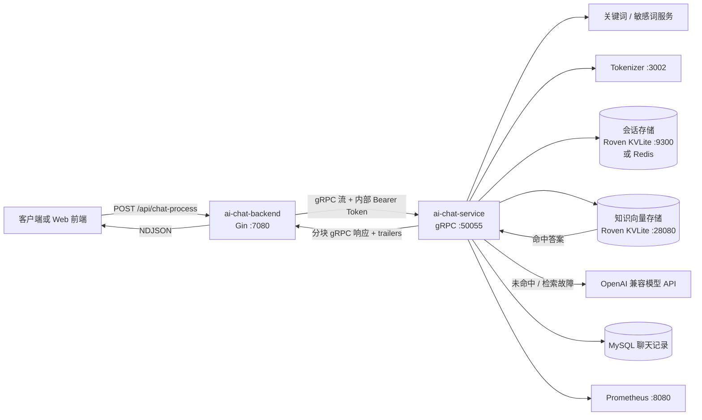
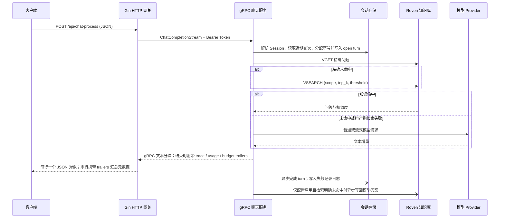

# Serva

Serva 是一个 Go 对话与知识检索服务：通过 HTTP 提供面向应用的聊天接口，由 gRPC 聊天服务调用 OpenAI 兼容模型，并把会话上下文和知识问答分别存入 Redis 与 Roven。对问题先做精确匹配，再进行 Roven 语义向量检索；符合阈值的命中直接返回，未命中或运行期检索失败时回源模型。


## 能力概览

- **对话 API**：Gin HTTP 网关把客户端请求转换为 gRPC 流，再转发为逐行 JSON 响应。
- **多轮会话**：使用 Session ID、递增 turn 序号和 TTL 保存用户/助手轮次；按配置载入最近轮次构造模型上下文。
- **模型接入**：Provider 注册表支持配置多个 OpenAI 兼容 Provider，按 Provider/Model 选择；支持普通和流式聊天。当前检索使用 Roven 服务端配置的 embedding 模型。
- **知识检索**：同一 scope 内先用 `VGET` 精确查询，再用 `VSEARCH` 查询 HNSW；超过阈值的首条命中直接回答，未命中、不可用或协议异常时调用模型。
- **知识维护**：提供要求 `approval_id` 的 `kvlite-ingest` 工具；运行时另有可配置的 LLM 未命中答案异步写回，开发配置默认打开，可能带来知识污染风险。
- **诊断**：gRPC health service 和独立 Prometheus 指标端口；HTTP `/api/health` 当前仅返回空的 HTTP 200，不代表依赖均健康。

## 架构与请求流程





HTTP 对话入口始终调用 gRPC `ChatCompletionStream`。Roven 命中时，服务仍会把完整答案拆成流式 chunk 返回。客户端断开后，HTTP 请求上下文会取消 gRPC 接收；外部 Provider 是否及时停止取决于其对取消上下文的处理。

## 快速开始

### 环境与依赖

- Linux、Go 1.21 及兼容的 Go 工具链（模块声明 `go 1.21`，toolchain 为 Go 1.22）。
- 初始化仓库 Submodule：

  ```bash
  git submodule update --init --recursive
  ```

- MySQL（聊天记录）、Redis、Roven 两个独立实例、Tokenizer、关键词和敏感词 gRPC 服务。
- 一个可用的 OpenAI 兼容聊天模型 API。请求可能产生上游费用；本 README 不会自动调用模型。
- 可选：Node.js 与 pnpm，用于开发前端。

默认开发端口：HTTP 网关 `7080`、聊天 gRPC `50055`、指标 `8080`、会话 Roven `9300`、知识 Roven `28080`、Tokenizer `3002`、过滤服务 `50053/50054`、前端 `5173`。端口和依赖地址应与实际环境配置一致。

### 配置密钥并启动

程序通过 `--config`（或 `-config`）读取 YAML；当前配置代码没有从环境变量覆盖这些项的机制。先复制配置到本地私有文件，再填入自己的 Provider Key、内部服务 Token、数据库凭据和地址。不要把填好密钥的文件提交到 Git。

```bash
cp ai-chat-service/dev.config.yaml ai-chat-service/dev.local.yaml
cp ai-chat-backend/dev.config.yaml ai-chat-backend/dev.local.yaml
# 编辑两个 dev.local.yaml，设置有效的凭据和可访问的依赖地址
```

向量实例必须使用 Roven 的向量配置（应用默认连接 `28080`，并检查 512 维、`core_hnsw_v2` 索引），会话实例使用独立的普通 KV 配置（默认 `9300`）。这两个实例的数据格式和用途不同，不能共用端口。

仓库脚本启动本地 mock/proxy、过滤服务、聊天服务和 HTTP 网关；它不会启动 MySQL、Redis、Tokenizer 或两个 Roven 实例，而且它固定读取各模块的 `dev.config.yaml`。使用 `dev.local.yaml` 时请手动启动应用，以确保加载本地配置：

```bash
# 终端 1：启动 gRPC 聊天服务（配置必须能连通全部依赖）
cd ai-chat-service
go run ./chat-server --config dev.local.yaml

# 终端 2：启动 HTTP 网关（配置中的 ai-chat-service 地址和 Token 须与上面匹配）
cd ../ai-chat-backend
go run ./cmd --config dev.local.yaml
```

这两条命令只有在 MySQL、Redis、Tokenizer、过滤服务、会话及向量 Roven 实例已启动且配置可达时才能完整工作。首次部署 Roven 时还需确认向量索引初始化完成（`VINFO` 的 `index_ready` 为 1，向量维度为 512，索引为 `core_hnsw_v2`）。根目录 `scripts/start_all_services.sh` 是使用默认开发配置的本地编排脚本，启动前要求向量 Roven 的端口已监听：

```bash
# 从仓库根目录运行；START_WEB=0 可跳过 pnpm 前端
START_WEB=0 ./scripts/start_all_services.sh start
./scripts/start_all_services.sh status
./scripts/start_all_services.sh stop
```

脚本管理自身启动的进程，日志和进程状态写入 `runtime/services/`。外部依赖需单独停止。收到 SIGINT/SIGTERM 时，服务会尝试优雅关闭。

首次创建聊天记录库时，可按当前 SQL 文件初始化 `ai_chat.chat_records`：

```bash
mysql -h 127.0.0.1 -u root -p < docs/sql/create_db.sql
```

Tokenizer 仓库只提供 Python 模块和容器启动定义，没有本地管理脚本；其 Dockerfile 使用 `nuxt` 命令。开发环境可在已安装 `tokenizer/requirements.txt` 依赖的 Python 环境运行：

```bash
cd tokenizer
python3 -m venv /tmp/serva-tokenizer-venv
/tmp/serva-tokenizer-venv/bin/pip install -r requirements.txt
/tmp/serva-tokenizer-venv/bin/nuxt --port 3002 --module tokenizer.py --workers 2
```

关键词和敏感词 gRPC 进程可由根目录 `scripts/start_all_services.sh` 启动，脚本固定读取 `keywords-filter/dev.config.yaml` 与 `dev.kw.config.yaml`。如使用自定义凭据/地址，应先核对并编辑本地私有配置后手动启动过滤服务。

### 健康检查与第一条请求

```bash
curl -i http://127.0.0.1:7080/api/health
curl -s http://127.0.0.1:7080/api/config
```

`/api/health` 当前是空响应体的 HTTP 200；聊天服务可另用仓库内探针检查 gRPC health：

```bash
ai-chat-service/grpc_health_probe-linux-amd64 -addr=127.0.0.1:50055
```

发起一轮新对话（`prompt` 必填；`options` 可以传空对象）。返回内容为 NDJSON：每一行是一个 JSON 对象，流结束时若收到 gRPC trailers，网关会额外输出一行含最终 `trace`、`usage` 和 `budget` 的对象。

```bash
curl -N http://127.0.0.1:7080/api/chat-process \
  -H 'Content-Type: application/json' \
  -d '{
    "prompt": "你好，请用一句话介绍自己。",
    "provider": "deepseek",
    "model": "deepseek-chat",
    "options": {"sessionId": "demo-session-001"}
  }'
```

如果希望用本地 mock Provider，请先核对 `mock-openai-api`、`openai-api-proxy` 及 Provider 配置的模型地址；不要假设启动脚本会自动把聊天 Provider 切到 mock。

### 添加知识并验证检索

人工审核入库工具读取聊天服务配置和 JSON manifest。`approval_id`、`document_id`、`question`、`answer` 及正数 `created_at` 均为必填；同一个问题和 scope 已存在不同 document ID 时会报冲突。

```json
{
  "approval_id": "review-2026-001",
  "document_id": "printer-help-v1",
  "question": "办公打印机无法打印怎么办？",
  "answer": "先检查打印机电源和网络连接，再确认电脑选择了正确的打印机队列。",
  "created_at": 1791504000
}
```

```bash
cd ai-chat-service
go run ./cmd/kvlite-ingest \
  -config dev.local.yaml \
  -input /path/to/reviewed-knowledge.json
```

随后用同一 scope 下的原问题或语义相近问题请求 `/api/chat-process`，查看返回对象中的 `trace.answer_mode`、`trace.cache_hit`、`trace.retrieved_hits`、`trace.semantic_top_score` 和 `trace.final_answer_source`。实际字段取决于本次路径和可用 metadata。Knowledge Roven 走模型回源时，若 `retrieval.kvlite.auto_writeback` 为 `true`，未命中后成功生成且通过简单答案过滤的回答会异步写回；开发配置开启该选项。生产使用前应关闭或增加审核和可信度策略。

## HTTP 与 gRPC API

### HTTP 网关

| Method | 路径 | 行为 |
| --- | --- | --- |
| `POST` | `/api/chat-process` | JSON 输入，代理 gRPC 流并返回逐行 JSON；失败目前也以 HTTP 200 + `status: "Fail"` 返回 |
| `GET`, `POST` | `/api/config` | 返回已启用 Provider 和模型目录，不返回 API Key |
| `GET` | `/api/models` | 当前复用 `/api/config` 响应，并非独立模型查询 |
| `POST` | `/api/session` | 固定返回 `auth: false`，不是会话 CRUD API |
| `GET` | `/api/health` | 空的 HTTP 200，不执行依赖检查 |
| `GET` | `/` | 返回网关工作目录下 `www/index.html`；其他未匹配路径尝试静态文件服务 |

聊天请求字段：

| 字段 | 类型 | 说明 |
| --- | --- | --- |
| `prompt` | string | 用户输入 |
| `provider` | string | 可选 Provider 名称 |
| `model` | string | 可选模型名 |
| `systemMessage` | string | 可选 system prompt；为空时使用服务配置中的 `bot_desc` |
| `options.sessionId` | string | 会话 ID；沿用已有会话时传回响应中的 `sessionId` |
| `options.parentMessageId` | string | 兼容旧式父消息链；若未传 Session ID，服务会尝试由消息 ID 映射恢复会话 |
| `options.name` | string | 前端兼容字段；聊天服务未用作模型路由字段 |

HTTP 响应使用 `application/octet-stream`，主体是 newline-delimited JSON，不是 SSE。增量对象包含 `id`、`sessionId`、`text`（截至当前 chunk 的累积文本）、`delta`（当前片段）、`role`、`detail` 等字段。最后一行可能带 `trace`、`usage`、`budget`。读取端应按换行解析并容忍流中断；网关不会提供标准 SSE `data:` 帧。

HTTP 网关没有面向调用者的鉴权中间件；网关发起 gRPC 调用时会附加配置的 Bearer Token，但 gRPC server 当前只为 unary RPC 注册鉴权拦截器，流式 RPC 使用的 interceptor 仅统计指标，未执行同一鉴权。因此 `/api/chat-process` 及其底层流式 RPC 当前不能视为已鉴权接口。

### gRPC 聊天服务

Proto 定义：[`ai-chat-service/proto/chat.proto`](ai-chat-service/proto/chat.proto)。服务名为 `ai_chat_service.zvoice.com.Chat`，监听开发配置中的 `0.0.0.0:50055`：

- `ChatCompletion(ChatCompletionRequest) returns (ChatCompletionResponse)`：一元非流式接口。
- `ChatCompletionStream(ChatCompletionRequest) returns (stream ChatCompletionStreamResponse)`：服务端流式接口；HTTP 网关使用此方法。
- 标准 gRPC health service 注册在相同端口。

`ChatCompletionRequest` 包含 `message`、`id`、`p_id`、`session_id`、`enable_context` 和 `chat_param`。后者支持 provider/model、max tokens、temperature、top_p、presence/frequency penalty、bot description、上下文 TTL 与最近 turn 数。错误以 gRPC status 返回；HTTP 网关会把建立流前的失败包装为 JSON `status: Fail`，流开始后的错误可能表现为连接提前结束。

## 配置

服务用 Viper 读取 YAML 文件，通过 `--config` 指定路径。环境变量覆盖未配置。主要配置文件：`ai-chat-service/dev.config.yaml` 与 `ai-chat-backend/dev.config.yaml`。

| 配置组 | 主要字段 | 用途 |
| --- | --- | --- |
| `server` / `http` | `ip`, `port`, `accessToken` | gRPC / HTTP 监听地址；gRPC 内部 Token |
| `providers[]` | `name`, `kind`, `base_url`, `api_key`, `default_model`, `models`, `enabled`, `priority`, `timeout_ms`, `context_window`, `model_aliases` | OpenAI 兼容聊天 Provider；按优先级选择默认 Provider，显式 `provider` / `model` 可覆盖选择 |
| `chat` | `model`, `max_tokens`, `temperature`, `top_p`, penalties, `bot_desc`, `min_response_tokens`, `context_ttl`, `context_len` | 模型生成和会话窗口参数 |
| `retrieval.kvlite` | `enabled`, `address`, `startup_policy`, `top_k`, `threshold`, `timeout_ms`, `pool_size`, `max_idle`, `auto_writeback` | Roven 向量服务连接与路由策略 |
| `retrieval.kvlite.scope` | `tenant`, `knowledge_base`, `corpus_version`, 可选 `provider`, `model`, `prompt_version` | 知识命名空间；写入和查询必须使用一致 scope |
| `context` | `context_backend`, `context_fallback_to_redis`, `context_namespace`, `kvlite.*` | 会话后端、命名空间、Roven/Redis 回退与连接参数 |
| `redis`, `mysql` | host/port/password、DSN、连接池 | 聊天记录和回退服务依赖 |
| `dependOn` | `sensitive`, `keywords`, `tokenizer` | 过滤和 tokenizer 下游地址及内部 Token |

知识 Roven 和会话 Roven 是两个独立配置块：`retrieval.kvlite` 控制 `VGET`/`VSEARCH`/`VSET` 向量接口；`context.kvlite` 控制会话键值读写。知识检索的向量维度、HNSW 类型和 metric 由 Roven 服务端索引配置决定，当前客户端健康检查要求 512 维和 `core_hnsw_v2`。

## 核心设计与边界

### 会话上下文

服务优先使用请求中的 `session_id`；缺省时可从 `id` / `p_id` 的兼容映射找回会话，否则生成新 Session ID。每轮分配递增序号，写入 open turn；完成回答后再更新为 completed。上下文按序读取最近 `context_len` 个已完成 turn，超出窗口的旧对话不进入当前 Prompt。会话键包括 session meta、turn 和兼容消息映射；TTL 由 `context_ttl` 控制。代码含内存热缓存以减少会话热路径读取。

用户 turn 的序号和 open 状态在模型请求前同步写入；assistant 完成记录在响应路径中由 goroutine 异步落库。因此它降低的是完成写入对响应的阻塞，不是所有会话操作都异步。进程在响应后、后台写完成前崩溃可能留下 open turn 或丢失 assistant 状态；写错误只记录日志。序号能排序已存储 turn，但并不保证同一会话的并发模型请求按客户端发起顺序完成。Roven 连接故障时，会话存储可按配置在超时/连接错误下回退 Redis；双后端并非强一致复制。

### Roven 向量客户端与检索

Go 客户端位于 `ai-chat-service/chat-server/retrieval/kvlite`。它管理 RESP TCP 连接池、连接/读/写 deadline、上下文 deadline、RESP 编码/解析和严格响应字段验证；知识操作映射到 `VINFO`、`VGET`、`VSEARCH`、`VSET`、`VDEL`。问句和 scope 编码为协议安全字符串，答案使用版本化 JSON 再做无填充 Base64URL 编码。响应字段、score、scope 或索引状态异常视作检索故障，不会构造伪命中。

请求顺序是：同 scope `VGET` 精确键匹配；没有精确记录时以 `top_k` 和 `threshold` 调用 `VSEARCH`（由 Roven HNSW 执行向量近邻搜索）；当前应用只消费排名第一的结果。得分过阈值时直接返回存储答案；未命中或运行期连接/协议/未就绪错误时，保留故障原因并继续调用模型。启动阶段是否拒绝服务取决于 `startup_policy`。Roven 服务端负责向量索引、embedding 和持久化；Serva 客户端不在本进程计算 embedding，也不实现 HNSW。

检索可能发生误命中、陈旧回答或 scope 配错。自动写回可能把偶发的模型回答固化为知识；源码只做非空/长度和少量低信息答案过滤，不等于人工审核。受控入库 CLI 是人工审核数据的首选路径。

### Provider 与流式生命周期

Provider 接口及注册表在 `ai-chat-service/chat-server/provider`；当前配置工厂创建 OpenAI-compatible Provider。每次请求按名称或模型 resolve Provider，使用 profile 超时传递取消上下文。Provider 错误向 gRPC 返回；当前没有通用熔断器、限流器或有界重试策略保证。provider 配置中的 `max_retries` 不能据此视为所有 Provider 请求都已自动重试。HTTP 响应开始后若上游失败，网关不能再改写已经发送的状态码，客户端可能只观察到流截断。

### 关键源码

- Gin 路由和 HTTP/gRPC 桥接：`ai-chat-backend/cmd/main.go`、`ai-chat-backend/pkg/controllers/chat.go`
- gRPC 入口和服务初始化：`ai-chat-service/chat-server/main.go`、`ai-chat-service/chat-server/server/server.go`
- Prompt 与会话装配：`ai-chat-service/chat-server/server/app.go`
- 知识路由：`ai-chat-service/chat-server/server/route.go`
- Roven 向量客户端/协议/编解码：`ai-chat-service/chat-server/retrieval/kvlite/`
- 会话数据模型及 Redis/Roven backend：`ai-chat-service/chat-server/chat-context/`
- Provider 接口和 OpenAI 兼容实现：`ai-chat-service/chat-server/provider/`

## 测试与性能记录

网关测试可直接运行。聊天服务大部分单元测试可在外部依赖之外运行，但向量客户端包中存在一个没有 opt-in 门控的 live test（`TestLiveSemanticNegativeTemp`），会固定连接 `127.0.0.1:28080`，并在连接成功时写入、清理 100 条临时记录。因此不要在真实数据实例上直接运行聊天服务的全量测试。

```bash
(cd ai-chat-backend && go test ./...)
(cd ai-chat-service && go test ./chat-server/chat-context ./chat-server/provider ./chat-server/server ./cmd/kvlite-ingest ./cmd/kvlite-calibrate ./cmd/kvlite-benchmark ./pkg/config)
(cd ai-chat-service && go test ./chat-server/retrieval/kvlite -run '^(TestCodecRoundTripWithDelimitedChineseMarkdownPayload|TestQuestionCodecRejectsMalformedEscapes|TestAnswerCodecRejectsOversizeAnswer|TestAnswerCodecRejectsEncodedPayloadOverLimit|TestParseVSearchItemRejectsMalformedOrUnsafeFields|TestScopeCodecRequiresBaseFields|TestKVLiteVectorStore.*|TestAppendHitsToTracePreservesVectorIdentity|TestControlledWriterRequiresApprovalAndDeduplicates)$')
```

编译入口：

```bash
(cd ai-chat-backend && go build -o /tmp/serva-http ./cmd)
(cd ai-chat-service && go build ./chat-server ./cmd/kvlite-ingest ./cmd/kvlite-calibrate ./cmd/kvlite-benchmark)
```

其他显式 opt-in 的 Roven 集成测试需要设置 `KVLITE_VECTOR_ADDR`、`KVLITE_VECTOR_WRITE_TEST=1` 或 `KVLITE_VECTOR_SEMANTIC_TEST=1`；其中写测试会创建临时文档并尝试清理。真实 Redis/Roven 性能测试需要两个可连接服务并设置 `RUN_REAL_BENCH=1` 等变量，运行前阅读 `ai-chat-service/scripts/bench_real_redis_vs_kvlite.sh`。全量 `go test ./...` 目前在没有本地 Roven 监听时会因上述未门控用例失败；该用例对 28080 可达时会写入临时数据。

一份历史设计记录报告：合成中文 fixture `qa_zh_1000.tsv`、50 个唯一答案文档、500 条查询、bge-small-zh-v1.5、512 维、Roven `core_hnsw_v2`、IP、top_k=1、threshold=-1、并发 4；Recall@1 为 0.984，P95 为 34.810ms，查询路径未调用大模型。

## 部署、运维与已知限制

- 根目录启动脚本只管理自身启动的本地进程，MySQL、Redis、Roven 和 Tokenizer 等外部依赖由操作者管理；它固定使用开发配置。
- 服务日志默认写入模块内 `runtime/logs/app.log`；统一脚本启动的服务另写入根目录 `runtime/services/logs/`。
- `ai-chat-stack/compose.yaml` 展示了容器编排拓扑，但镜像构建、密钥管理、数据备份与公开环境发布仍需按环境配置；不能据此视作开箱即用生产部署。
- gRPC 指标 HTTP 服务监听 `:8080`。HTTP 网关 health handler 没有检查下游服务，脚本以其可连接作为网关端口就绪信号。
- Roven 主从复制 / 向量高可用未由当前集成验证证明；会话 fallback 也不等于跨存储强一致。需自行规划 Roven 数据备份和恢复演练。
- 聊天记录异步写 MySQL；上下文完成和知识写回也在后台 goroutine 中执行，故进程退出或崩溃会有写入丢失窗口。
- HTTP 请求没有外部用户鉴权；日志会记录请求错误，自动写回成功日志包含问题文本，部署时应评估隐私和日志保留策略。
- gRPC 鉴权仅接入 unary interceptor；流式聊天 RPC 未接入鉴权，这是公开部署前需修复的安全边界。
- 知识检索依赖 Roven 初始化向量索引；会话依赖 Redis 或 Roven session KV；聊天依赖 Provider、Tokenizer、关键词/敏感词服务、MySQL 和 Redis 初始化连接。
- 根目录未发现明确许可证文件。发布前需补充许可证、轮换已跟踪开发配置中的凭据，并核对 Submodule 分发许可。

## 项目结构

```text
.
├── ai-chat-backend/       # Gin HTTP 网关与前端兼容 API
├── ai-chat-service/       # gRPC 聊天服务、Provider、上下文和 Roven 客户端
├── ai-chat-stack/         # Compose 部署拓扑与配置样例
├── ai-chat-web/           # Web 前端
├── keywords-filter/       # 关键词及敏感词过滤 gRPC 服务
├── tokenizer/             # Tokenizer 服务
├── mock-openai-api/       # OpenAI 兼容模拟服务
├── openai-api-proxy/      # OpenAI 兼容代理
├── KVLite/                # Roven 存储引擎 Submodule（历史目录名）
├── scripts/               # 本地多服务启动/停止脚本
└── docs/                  # 架构、集成、校准和开发文档
```

Go 模块分布于 `ai-chat-backend`、`ai-chat-service`、`keywords-filter`、`tokenizer`、`mock-openai-api` 和 `openai-api-proxy`；仓库根目录不是 Go module。

## 相关项目与许可

- Roven：[github.com/208822032/Roven](https://github.com/208822032/Roven)。本仓库通过 `KVLite` Submodule 和 RESP 客户端与其交互；应用侧连接、检索策略和数据编解码由 Serva 负责，向量索引与存储由 Roven 负责。
- 当前 Submodule 声明的远端为项目内部 GitLab 地址；请在公开分发前确认它与上述 GitHub 项目是同一源码版本，并检查其许可证和可访问性。
- 本仓库当前未发现根目录 `LICENSE` 文件，因此这里不声明 Sevra/Serva 仓库的开源许可证。
