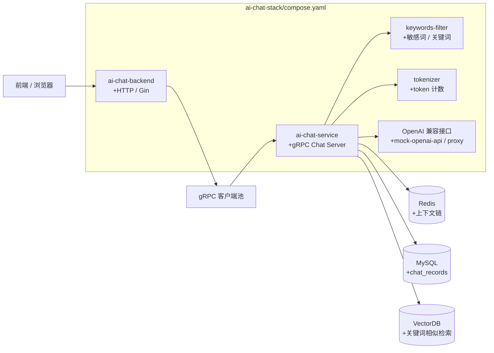
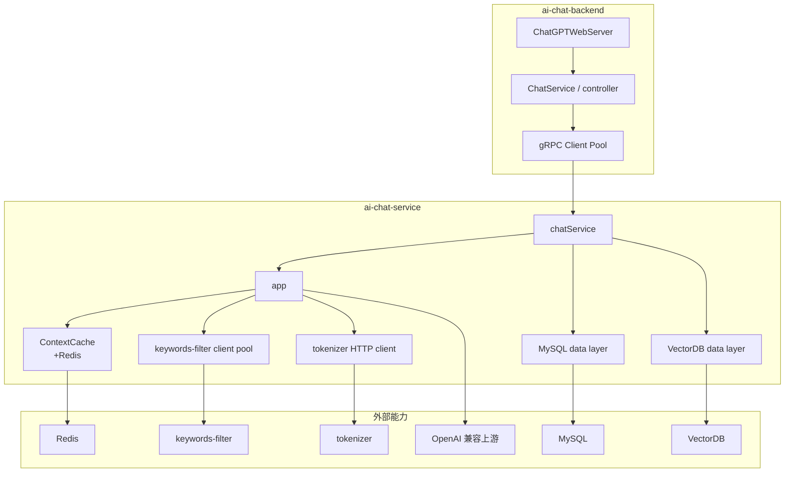

# ai-chat 项目代码导读手册（面向零 Go 基础）

## 0. 阅读前说明

这份手册不是“把仓库里每个文件都翻译一遍”，而是先帮你建立一个可复用的认知框架：

- 先看这个项目整体是怎么分层的
- 再看服务是怎么启动的
- 再顺着一条真实请求把代码走完
- 最后把你会卡住的 Go 语法和机制单独拎出来

这个仓库不是单体程序，而是一组独立 Go module 组成的聊天系统。根据当前仓库和调用关系，可以把它理解成：

- `ai-chat-backend`：面向前端的 HTTP 网关
- `ai-chat-service`：核心聊天推理和业务编排服务，使用 gRPC 暴露接口
- `keywords-filter`：关键词 / 敏感词过滤服务，提供 gRPC 能力
- `tokenizer`：token 计数服务，提供 HTTP 能力
- `openai-api-proxy`：OpenAI 兼容代理服务
- `mock-openai-api`：本地模拟 OpenAI 兼容接口的替身服务
- `ai-chat-stack/compose.yaml`：把这些服务拼起来的部署说明

说明：上面几个模块里，`ai-chat-backend` 和 `ai-chat-service` 是主链路；`keywords-filter`、`tokenizer`、`mock-openai-api`、`openai-api-proxy` 是支撑链路。个别模块在当前代码里是“根据目录和配置推测”其作用，文档里会明确标注。

---

## 1. 项目全景导读

### 1.1 用大白话说，这个项目是干什么的

这个 ai-chat 项目本质上是一个“带上下文记忆、带敏感词过滤、带关键词命中缓存、支持流式输出的聊天后端系统”。

它解决的不是“怎么调用一次大模型”这么简单，而是把一次聊天请求变成一个可上线的服务：

- 前端发来一段用户问题
- 网关层接住请求并转发给核心聊天服务
- 核心服务先检查敏感词
- 再做关键词提取，看看能不能命中已有问答
- 没命中才去调用 OpenAI 兼容接口
- 结果返回后还要把上下文、聊天记录、向量索引异步存起来

所以它更像这些系统的组合：

- 聊天服务 API 层
- LLM 接入层
- 简化版 RAG / 记忆系统
- 风控过滤系统
- 业务数据持久化系统

如果类比现实系统：

- `ai-chat-backend` 像客服前台接待员，负责接请求、转单、流式把回复递回去
- `ai-chat-service` 像真正的客服中台，负责判断能不能直接回答、要不要查历史、要不要调用模型
- `keywords-filter` 像审核员和关键词检索员
- `tokenizer` 像字数统计工具
- `Redis` 像短期记忆本
- `MySQL` 像历史工单库
- `VectorDB` 像“相似问题索引库”
- `mock-openai-api` 像练习用的假客服
- `openai-api-proxy` 像在特定网络环境下转发 OpenAI 请求的中转站

### 1.2 系统整体怎么协作



### 1.3 这个项目更接近哪一类系统

它不是纯前端聊天页，也不是单纯的模型调用封装，而是：

- 以聊天 API 为入口
- 以 gRPC 服务做核心编排
- 以缓存、数据库、向量检索做增强
- 以流式输出提升交互体验

因此它最像“LLM 接入层 + 记忆层 + 风控层 + 业务持久化”的组合系统。

### 1.4 核心目录与模块地图（只保留关键目录）

```text
ai-chat-backend/
  cmd/main.go                  # HTTP 网关入口
  pkg/config/                  # 配置加载
  pkg/controllers/chat.go      # /api/chat-process 的核心 handler
  pkg/middlewares/             # CORS、限流等 HTTP 中间件
  services/ai-chat-service/    # gRPC 客户端池

ai-chat-service/
  chat-server/main.go          # gRPC 核心服务入口
  chat-server/server/          # Chat 业务主逻辑
  chat-server/server/app.go    # 单次请求的处理上下文与 OpenAI 请求构建
  chat-server/chat-context/     # Redis 上下文链
  chat-server/data/             # MySQL 聊天记录存取
  chat-server/vector-data/      # VectorDB 相似检索与写入
  chat-server/metrics-app/      # gRPC 流拦截器指标
  chat-server/metrics-bus/      # 业务计数指标
  interceptor/auth.go           # gRPC 鉴权拦截器
  services/grpc-client/         # gRPC 连接池封装
  services/keywords-filter/     # 关键词 / 敏感词服务客户端池
  services/tokenizer/           # token 计数 HTTP 客户端
  proto/chat.proto              # 核心 gRPC 协议定义

keywords-filter/
  filter-server/main.go         # 关键词/敏感词服务入口
  filter-server/interceptor/    # gRPC 鉴权
  filter-server/server/         # 过滤服务实现
  pkg/filter/                   # 字典初始化与过滤逻辑

tokenizer/
  tokenizer.py                  # token 计算服务实现（按 README 启动）

openai-api-proxy/
  main.go, routers/, proxy/     # OpenAI 兼容反向代理

mock-openai-api/
  main.go                       # 本地模拟 OpenAI 兼容接口

ai-chat-stack/
  compose.yaml                  # 多服务编排部署
  configs/*.yaml                # 各服务配置
```

### 1.5 模块职责说明

| 模块 | 做什么 | 主要交互对象 | 价值 |
|---|---|---|---|
| `ai-chat-backend` | 接前端 HTTP 请求，转成 gRPC 调用核心服务，再把流式结果转回前端 | 浏览器/前端、`ai-chat-service` | 把前端和核心业务隔离开 |
| `ai-chat-service` | 做真正的聊天编排：过滤、命中缓存、调用模型、保存上下文和记录 | Redis、MySQL、VectorDB、OpenAI、关键词服务、tokenizer | 系统核心大脑 |
| `keywords-filter` | 做敏感词校验与关键词提取 | `ai-chat-service` | 风控和问答命中增强 |
| `tokenizer` | 按模型算 token 数 | `ai-chat-service` | 让上下文长度控制更准确 |
| `openai-api-proxy` | 提供 OpenAI 兼容转发 | OpenAI 或上游兼容接口 | 网络受限环境下的代理入口 |
| `mock-openai-api` | 返回模拟回答 | 本地开发 / 测试 | 让项目离线也能跑 |

### 1.6 启动主线的粗粒度概览

这个项目不是一个进程启动全部功能，而是多个进程分别启动，再通过配置和网络拼成一个系统。

#### 核心链路的启动概况

1. `ai-chat-service/chat-server/main.go` 启动核心 gRPC 服务
2. 它先加载配置，再初始化日志、MySQL、Redis、VectorDB
3. 然后创建 gRPC server，挂上鉴权拦截器和指标拦截器
4. 注册 `Chat` 服务实现，开始监听端口
5. `ai-chat-backend/cmd/main.go` 启动 HTTP 网关
6. 它加载配置、初始化日志，绑定 Gin 路由和中间件
7. `/api/chat-process` 收到请求后，再通过 gRPC 调用 `ai-chat-service`

#### 哪些是框架初始化

- 配置加载：`config.InitConfig(...)`
- 日志初始化：`log.SetLevel(...)`、`log.SetOutput(...)`
- HTTP / gRPC server 创建：Gin、`grpc.NewServer(...)`
- 中间件 / 拦截器挂载：CORS、鉴权、指标

#### 哪些是业务初始化

- MySQL / Redis / VectorDB 连接初始化
- `Chat` 服务实现对象创建
- gRPC 客户端池创建
- 上下文缓存创建
- 关键词提取、敏感词校验、token 计数这些业务能力接入

### 1.7 请求主线的粗粒度概览

最核心的一条链路是“前端发起一次聊天请求”。粗略路径是：

```text
前端 / 浏览器
  -> ai-chat-backend 的 /api/chat-process
  -> gRPC 客户端池
  -> ai-chat-service 的 ChatCompletionStream
  -> 敏感词检查 / 关键词提取
  -> Redis 上下文链 / VectorDB 命中判断
  -> OpenAI 兼容接口
  -> 返回流式响应
  -> 异步落库到 Redis / MySQL / VectorDB
```

### 1.8 新手阅读建议

第一遍应该重点关注：

- 入口文件：`ai-chat-backend/cmd/main.go`、`ai-chat-service/chat-server/main.go`
- 真正的业务主线：`ai-chat-backend/pkg/controllers/chat.go`、`ai-chat-service/chat-server/server/server.go`
- 请求构造和上下文拼接：`ai-chat-service/chat-server/server/app.go`
- 存储与缓存：`chat-context/redis.go`、`data/chat_records.go`、`vector-data/chat_records.go`

第一遍可以故意忽略：

- 生成代码文件，比如 `proto/chat.pb.go`、`proto/chat_grpc.pb.go`
- 指标实现的细节，比如 Prometheus 的每一个 label
- log 组件的内部实现
- Dockerfile 和镜像构建细节，先知道它们的存在即可

最值得优先看的文件：

1. `ai-chat-backend/cmd/main.go`
2. `ai-chat-backend/pkg/controllers/chat.go`
3. `ai-chat-service/chat-server/main.go`
4. `ai-chat-service/chat-server/server/server.go`
5. `ai-chat-service/chat-server/server/app.go`
6. `ai-chat-service/chat-server/chat-context/redis.go`
7. `ai-chat-service/chat-server/data/chat_records.go`
8. `ai-chat-service/chat-server/vector-data/chat_records.go`

第一遍不要陷进去的复杂细节：

- token 计算公式的每个数字为什么是这样，先知道它在控制上下文就够了
- Prometheus 指标命名，先知道它在统计请求量和错误量
- gRPC 生成代码的字段映射，先看 `.proto` 文件就行

### 1.9 第一轮结尾建议深挖的 5 到 8 个文件 / 函数 / 结构体

1. `ai-chat-backend/pkg/controllers/chat.go` 中的 `ChatProcess`：这是 HTTP 入口到 gRPC 的桥梁
2. `ai-chat-service/chat-server/main.go`：能看清核心服务怎么挂起来
3. `ai-chat-service/chat-server/server/server.go` 中的 `ChatCompletionStream`：核心请求链路
4. `ai-chat-service/chat-server/server/app.go` 中的 `buildChatCompletionRequest`：请求上下文怎么拼
5. `ai-chat-service/chat-server/server/app.go` 中的 `getContext` 和 `saveContext`：Redis 上下文链怎么走
6. `ai-chat-service/chat-server/chat-context/redis.go`：Redis 缓存怎么读写
7. `ai-chat-service/chat-server/data/chat_records.go`：MySQL 怎么存历史聊天
8. `ai-chat-service/chat-server/vector-data/chat_records.go`：向量检索怎么做相似命中

---

## 2. 核心目录与模块地图

### 2.1 关键目录树

```text
ai-chat-backend/
  cmd/main.go
  pkg/config/config.go
  pkg/controllers/chat.go
  pkg/middlewares/cors.go
  services/ai-chat-service/ai-chat-service.go
  services/grpc-client/

ai-chat-service/
  chat-server/main.go
  chat-server/server/server.go
  chat-server/server/app.go
  chat-server/chat-context/chat_context.go
  chat-server/chat-context/redis.go
  chat-server/data/chat_records.go
  chat-server/vector-data/chat_records.go
  chat-server/metrics-app/metrics_app.go
  chat-server/metrics-bus/metrics_bus.go
  interceptor/auth.go
  pkg/config/config.go
  pkg/db/mysql/mysql.go
  pkg/db/redis/redis.go
  pkg/db/vector/vector.go
  services/grpc-client/
  services/keywords-filter/
  services/tokenizer/tokenizer.go
  proto/chat.proto

keywords-filter/
  filter-server/main.go
  filter-server/interceptor/auth.go
  filter-server/server/
  pkg/filter/

mock-openai-api/
  main.go
  middleware/auth.go
  pkg/config/config.go

openai-api-proxy/
  main.go
  routers/routers.go
  proxy/proxy.go
  middleware/

ai-chat-stack/
  compose.yaml
  configs/
```

### 2.2 目录职责速记

- `cmd/`、`main.go`：程序入口，负责把配置、日志、server 这些组件拼起来
- `pkg/config/`：统一读取 yaml 配置
- `pkg/controllers/`、`chat-server/server/`：真正业务处理逻辑
- `services/`：各种远程能力的客户端封装
- `chat-context/`：聊天上下文的缓存实现
- `data/`、`vector-data/`：历史记录和向量检索的数据访问层
- `interceptor/`、`middleware/`：横切逻辑，像鉴权、限流、CORS、指标
- `proto/`：gRPC 协议定义

### 2.3 这套结构的好处

这个项目并不是那种“所有代码都堆在 handler 里”的写法，而是把职责拆成了几层：

- 接口层负责收请求
- 编排层负责判断和拼装
- 数据层负责读写外部存储
- 客户端层负责调用远端服务

这非常适合后端经验已经有、但 Go 基础还不熟的人读，因为你可以先按“HTTP 入口 -> 业务编排 -> 数据访问 -> 外部服务”这条线来理解。

---

## 3. 启动流程分析

### 3.1 系统里其实有多个启动入口

这个项目至少有 4 类可独立启动的服务：

1. `ai-chat-backend`：HTTP 网关
2. `ai-chat-service`：聊天核心 gRPC 服务
3. `keywords-filter`：关键词 / 敏感词 gRPC 服务
4. `mock-openai-api` / `openai-api-proxy` / `tokenizer`：支撑服务

如果只看“聊天请求真正穿透的主链路”，最重要的是前两个。

### 3.2 `ai-chat-backend` 的启动顺序

入口文件：`ai-chat-backend/cmd/main.go`

1. `main()` 先 `flag.Parse()` 读取 `--config`
2. `config.InitConfig(*configFile)` 读取 yaml
3. `log.SetLevel(...)`、`log.SetOutput(...)`、`log.SetPrintCaller(true)` 初始化日志
4. 创建 `ChatGPTWebServer`，把配置和 logger 注入进去
5. `webServer.Run(ctx)` 启动 HTTP 服务协程
6. `httpServer(ctx)` 里调用 `controllers.NewChatService(...)`
7. 创建 Gin 引擎 `gin.Default()`
8. 挂载 `middlewares.Cors()`
9. 注册路由：
   - `POST /api/chat-process`
   - `POST /api/config`
   - `POST /api/session`
   - `GET /api/health`
10. 静态文件和前端页面通过 `www/` 暴露
11. `server.ListenAndServe()` 开始监听
12. 收到退出信号后通过 `server.Shutdown(...)` 优雅关闭

人话解释：

- 前半段都是“把环境准备好”
- 后半段才是“开始接请求”
- `ChatProcess` 真正决定聊天请求怎么转发

### 3.3 `ai-chat-service` 的启动顺序

入口文件：`ai-chat-service/chat-server/main.go`

1. `flag.Parse()` 读取配置路径
2. 初始化 Prometheus registry 和基础 collector
3. 启动 `/metrics` HTTP 端点
4. `config.InitConfig(*configFile)` 加载配置
5. 设置日志等级和日志输出
6. 初始化 MySQL：`mysql.InitMysql(cnf)`
7. 初始化 Redis：`redis.InitRedisPool(cnf)`
8. 初始化 VectorDB：`vector.InitDB(cnf)`
9. 构造 `recordsData := data.NewChatRecordsData(mysql.GetDB())`
10. `net.Listen` 监听 gRPC 端口
11. `grpc.NewServer(...)` 创建 gRPC server，并挂上：
    - `interceptor.UnaryAuthInterceptor`
    - `metrics_app.NewStreamMiddleware(registry).WrapHandler()`
12. 创建核心业务实现：`server.NewChatService(...)`
13. `proto.RegisterChatServer(s, service)` 注册服务
14. 注册健康检查服务
15. `s.Serve(lis)` 开始接收 gRPC 请求

人话解释：

- 这一步是在把“聊天大脑”正式装进一个可监听端口的服务进程里
- 数据库、缓存、向量库都要先准备好，因为后面的请求会用到

### 3.4 支撑服务的启动顺序

#### `keywords-filter/filter-server/main.go`

1. 读取配置和字典路径
2. 如果带 `--format`，先格式化字典后退出
3. 初始化日志
4. `filter.InitFilter(*dictFile)` 加载过滤规则
5. `grpc.NewServer(grpc.UnaryInterceptor(...))`
6. 注册过滤服务
7. 注册健康检查
8. `Serve` 开始监听

#### `mock-openai-api/main.go`

1. 读取配置
2. `gin.SetMode(...)`
3. 注册 `/health`
4. 注册鉴权中间件
5. 提供 `/v1/chat/completions`，同时支持普通响应和流式响应

#### `openai-api-proxy/main.go` / `routers/routers.go` / `proxy/proxy.go`

1. 读取配置和日志
2. 创建 Gin 路由
3. 挂 `/health`
4. 挂代理认证和限流中间件
5. 把 `/v1/*` 的请求反向代理到上游 OpenAI 兼容服务

### 3.5 启动时哪些是通用代码，哪些是真业务

#### 通用代码

- 参数解析：`flag.Parse()`
- 配置加载：`viper` 读 yaml
- 日志初始化
- 服务器创建：Gin / gRPC
- 信号处理与优雅关闭

#### 真业务代码

- `ai-chat-service` 里的 MySQL、Redis、VectorDB 初始化
- `Chat` 服务注册
- `ChatCompletion` / `ChatCompletionStream` 的处理逻辑
- `keywords-filter`、`tokenizer`、OpenAI 兼容上游的调用

### 3.6 核心对象关系图



### 3.7 当前项目中最值得先理解的设计思想

#### 分层架构

项目明显按“入口层 / 业务编排层 / 数据访问层 / 客户端层”来拆。

- `controller` / `handler` 负责接请求
- `server` / `app` 负责业务决策
- `data` / `vector-data` / `chat-context` 负责存储
- `services/*` 负责远程调用

这能让请求路径比较清晰：先看入口，再看编排，再看数据。

#### 接口抽象

典型例子：

- `chat_context.ContextCache`
- `data.IChatRecordsData`
- `vector_data.IChatRecordsData`
- `grpc_client.ClientPool`

人话理解：

- 先定义“我需要什么能力”，再决定 Redis、MySQL 或别的实现怎么接进去

#### 依赖注入风格

很多对象不是内部自己 new 出来的，而是在 `main()` 里拼装后传进去。

例如 `server.NewChatService(recordsData, vectorData, cnf, logger, busMetrics)`。

好处是：

- 启动逻辑清楚
- 依赖关系透明
- 便于替换实现和测试

#### 流式输出

`ChatCompletionStream` 把模型返回一段一段往客户端推，这是这个项目体验感最强的部分。

#### 配置驱动

模型参数、token 上限、上下文长度、数据库地址、服务地址，基本都在 yaml 里。

这意味着调试时要先看配置，而不是只盯代码。

#### repository / data 层模式

MySQL 和 VectorDB 的读写都单独放在 data 层，不让 handler 直接写 SQL 或 SDK 细节。

---

## 4. 核心对象与模块协作关系

### 4.1 对象怎么互相持有

- `ChatGPTWebServer` 持有 `config` 和 `log`
- `ChatService`（backend controller）也持有 `config` 和 `log`
- `chatService`（service 端核心结构体）持有 `config`、`log`、`data`、`vectorData`、`busMetrics`
- `app` 持有单次请求的 `openaiConf`、`log`、`contextCache`
- `redisCache` 持有一个 Redis client
- `chatRecordsData` 持有 `*sql.DB`
- `vector_data.chatRecordsData` 持有 `*tcvectordb.Client`

### 4.2 谁依赖谁

- backend controller 依赖 `ai-chat-service` 的 gRPC 接口
- `ai-chat-service` 依赖 `keywords-filter`、`tokenizer`、Redis、MySQL、VectorDB、OpenAI 上游
- `app` 依赖 `chatService` 提供的配置和 logger
- `chatService` 依赖 `app` 来构造请求和管理上下文

### 4.3 生命周期大概如何

- `main()` 里创建的大对象通常是“进程级”生命周期
- `app` 是“单次请求级”临时对象
- Redis / gRPC / MySQL / VectorDB client 是“复用型”连接对象

### 4.4 最关键的对象关系

```text
前端请求
  -> backend ChatProcess
  -> gRPC client pool
  -> ai-chat-service chatService
  -> app
  -> 外部依赖：keywords-filter / tokenizer / Redis / MySQL / VectorDB / OpenAI
```

---

## 5. 一条核心业务链路精读

### 5.1 选择的典型链路

我选择“**一次流式聊天请求**”作为主链路。

原因很简单：它最能体现这个项目的核心价值，里面同时包含了：

- HTTP 到 gRPC 的跨进程转发
- 敏感词过滤
- 关键词检索
- 上下文记忆
- OpenAI 调用
- 流式返回
- 异步落库

### 5.2 链路总览

```text
前端 / 浏览器
  -> ai-chat-backend/pkg/controllers/chat.go: ChatProcess
  -> ai-chat-backend/services/ai-chat-service/ai-chat-service.go: GetAiChatServiceClientPool
  -> ai-chat-backend/services/grpc-client
  -> ai-chat-service/chat-server/server/server.go: ChatCompletionStream
  -> ai-chat-service/chat-server/server/app.go: newApp / sensitive / keywords / buildChatCompletionRequest
  -> keywords-filter 服务
  -> tokenizer 服务
  -> Redis / MySQL / VectorDB
  -> OpenAI 兼容上游（本地 mock 或代理）
  -> 返回流式响应
```

### 5.3 详细调用顺序

#### 第 1 步：请求进入 HTTP 网关

文件：`ai-chat-backend/pkg/controllers/chat.go`

函数：`ChatProcess(ctx *gin.Context)`

它先做：

1. `ctx.BindJSON(&payload)` 解析前端请求
2. 如果解析失败，直接返回 `Fail`
3. 生成一个新的 `messageID`
4. 先构造一个空的结果对象 `result`

人话解释：

- 这层只负责“把前端语义变成内部请求”，不做真正 AI 决策

#### 第 2 步：拿到 gRPC 连接并加鉴权头

文件：`ai-chat-backend/services/ai-chat-service/ai-chat-service.go`

函数：`GetAiChatServiceClientPool()`

再往下会用：

- `services/grpc-client` 里的连接池
- `services.AppendBearerTokenToContext(context.Background(), accessToken)` 注入鉴权 metadata

这里有一个很重要的点：当前代码是从 `context.Background()` 开始构造 gRPC 上下文，而不是继承 HTTP request 的 context。

这意味着：

- 上游 HTTP 请求取消时，gRPC 这边不一定自动跟着取消
- 这个点和请求取消语义有关，读代码时要特别注意

#### 第 3 步：构造 gRPC 请求

还是在 `ChatProcess` 中：

- `Id`：本次消息 ID
- `Message`：用户输入 `payload.Prompt`
- `Pid`：前一条消息 ID，来自 `payload.Options.ParentMessageId`
- `EnableContext`：如果有父消息 ID，就打开上下文
- `ChatParam`：把后台配置里的模型参数、上下文参数一起传给核心服务

人话解释：

- 网关层不会自己理解模型参数，它只是把配置搬过去

#### 第 4 步：调用 gRPC 流式接口

文件：`ai-chat-service/proto/chat.proto`

RPC：`ChatCompletionStream(ChatCompletionRequest) returns (stream ChatCompletionStreamResponse)`

调用点：`aiChatServiceClient.ChatCompletionStream(ctx1, in)`

如果失败，HTTP 层直接返回 `Fail`。

#### 第 5 步：HTTP 网关把 gRPC 流转成 HTTP 流

`ChatProcess` 会不断调用 `stream.Recv()`：

1. 收到一条 gRPC chunk
2. 更新 `result.ID`、`result.Delta`、`result.Text`、`result.Detail`
3. `json.Marshal(result)`
4. 通过 `ctx.Writer.Write(...)` 一行一行写回前端
5. `Flush()` 及时刷出

人话解释：

- 这层像“翻译器”，把 gRPC 流翻译成前端能消费的 HTTP 流式输出

#### 第 6 步：核心服务接收 gRPC 流请求

文件：`ai-chat-service/chat-server/server/server.go`

函数：`ChatCompletionStream(in *proto.ChatCompletionRequest, stream proto.Chat_ChatCompletionStreamServer) error`

这里做的第一件事是创建 Redis 上下文缓存：

- `chat_context.NewRedisCache()`
- `defer redisContextCache.Close()`

然后调用：

- `s.newApp(in, redisContextCache)`

这个 `app` 是“单次请求处理对象”，里面装着本次请求要用的配置和上下文缓存。

#### 第 7 步：敏感词检查

在 `app.sensitive(in)` 里：

1. 从 `services/keywords-filter` 取敏感词客户端池
2. 从池里拿一个 gRPC conn
3. 通过 `services.AppendBearerTokenToContext(...)` 带上 token
4. 调用 `Validate(ctx, req)`

如果命中敏感词：

- 不会继续走 OpenAI
- 直接构造“触发到了知识盲区，请换个问题再问”这类回复
- 流式发给前端

人话解释：

- 这是第一道门，先拦危险问题

#### 第 8 步：关键词提取与相似命中

在 `app.keywords(in)` 里：

1. 调关键词服务 `FindAll`
2. 拿到关键词列表
3. 如果关键词不为空，查 VectorDB
4. 如果相似度足够高，回 MySQL 找历史记录
5. 命中后直接把历史答案流式返回

这里的意思是：

- 这套系统并不总是每次都真的问模型
- 有些问题可能直接命中历史答案

这就是它最像“轻量 RAG + 缓存问答系统”的地方。

#### 第 9 步：如果没命中，就组装 OpenAI 请求

文件：`ai-chat-service/chat-server/server/app.go`

函数：`buildChatCompletionRequest(in, false)`

它会做三件事：

1. 构造当前用户消息 `currMessage`
2. 如果 `EnableContext` 为真，从 Redis 沿着 `PID` 链往回捞上下文
3. 调 `rebuildMessages(...)` 拼出最终的 `Messages`

这里非常关键，因为它决定模型实际上看到了什么上下文。

#### 第 10 步：上下文 token 计算与截断

还是 `rebuildMessages(...)`：

- 如果 `BotDesc` 不为空，先构造 system message
- 调 tokenizer 算 system message token 数
- 再调 tokenizer 算当前消息 token 数
- 如果当前消息本身就超限，直接报“请求消息超限”
- 然后按上下文长度和 token 上限，一条一条往里加历史消息
- 最后把消息顺序倒回去，确保 OpenAI 看到的是正确顺序

人话解释：

- 这一步像在给模型“整理饭盒”，不是想塞多少塞多少，而是要在上下文长度范围内尽量放最有用的内容

#### 第 11 步：调用 OpenAI 兼容接口

文件：`ai-chat-service/chat-server/server/app.go`

函数：`getOpenaiClient()`

它用的是：

- `openai.DefaultConfig(accessToken)`
- 然后把 `BaseURL` 改成配置里的地址

说明：当前仓库的本地配置把这个地址指向了本地模拟服务 `mock-openai-api` 的端口，而不是直接调用真实 OpenAI。

这一步如果在流式模式下，会用：

- `client.CreateChatCompletionStream(stream.Context(), req)`

#### 第 12 步：边接收边转发流式数据

`ChatCompletionStream` 会循环：

1. `chatStream.Recv()` 收到一段模型输出
2. 拼接 `completionContent`
3. JSON 转成 proto 流响应
4. `stream.Send(res)` 立刻发给上游 HTTP 网关

人话解释：

- 这就是实时打字效果的来源

#### 第 13 步：流结束后异步保存上下文和记录

流结束后，代码启动两个 goroutine：

1. 一个负责把本次问答写到 Redis 上下文链
2. 一个负责把聊天记录写到 MySQL，并在有关键词时写入 VectorDB

这也说明一个很重要的事实：

- 这个项目不是先完整落库再返回，而是先把用户体验做好，再把数据异步整理好

### 5.4 数据结构在中间怎么变化

#### HTTP 入参

`ChatMessageRequest`

- `prompt`
- `options.parentMessageId`

#### gRPC 入参

`proto.ChatCompletionRequest`

- `Id`
- `Message`
- `Pid`
- `EnableContext`
- `ChatParam`

#### 上下文缓存对象

`chat_context.ChatMessage`

- 当前消息 ID
- 上一条消息 ID
- 消息内容
- token 数

#### MySQL 持久化对象

`data.ChatRecord`

- 用户问题
- AI 回复
- token 数
- 关键词
- 创建时间

#### VectorDB 对象

`vector_data.ChatRecord`

- 文档 ID
- KVs，当前主要是 `keywords`

### 5.5 新手最容易迷路的地方

1. `app` 和 `chatService` 两层名字都很像，但职责不同：`chatService` 是 gRPC 服务实现，`app` 是单次请求的处理助手
2. `EnableContext` 为真时，真正的上下文不是一整个 session，而是 Redis 里按 `ID/PID` 串起来的链
3. 流式返回不是一次性 return，而是边接收边写 HTTP body
4. 落库是异步 goroutine 做的，不是主响应路径的一部分
5. `context.Background()` 被多处使用，意味着很多上游取消语义没有完全传到底

### 5.6 最值得打断点的地方

如果你要调试一条请求，我建议断在这些点：

1. `ai-chat-backend/pkg/controllers/chat.go: ChatProcess`
2. `ai-chat-service/chat-server/server/server.go: ChatCompletionStream`
3. `ai-chat-service/chat-server/server/app.go: buildChatCompletionRequest`
4. `ai-chat-service/chat-server/server/app.go: rebuildMessages`
5. `ai-chat-service/chat-server/server/app.go: sensitive`
6. `ai-chat-service/chat-server/server/app.go: keywords`
7. `ai-chat-service/chat-server/chat-context/redis.go: Get / Set`
8. `ai-chat-service/chat-server/data/chat_records.go: Add`

### 5.7 为什么这条链最有代表性

因为它把项目的核心价值一次性都打出来了：

- 前端接入
- gRPC 转发
- 鉴权
- 风控
- 关键词增强
- 上下文拼接
- 模型调用
- 流式返回
- 异步存储

读懂它，基本就读懂了这个项目 80% 的实质。

---

## 6. 项目里必须掌握的 Go 知识点

这里只讲本项目真的出现过的 Go 知识点，不讲空泛语法。

| 知识点 | 代码位置 | 你要怎么理解 |
|---|---|---|
| `package` / `import` | 全仓库 | Go 不是“类文件”组织，而是按包组织 |
| `struct` | `config.go`、`server.go`、`app.go`、`chat.go` | 结构体就是“带字段的数据容器” |
| `interface` | `chat-context/chat_context.go`、`data/chat_records.go`、`vector-data/chat_records.go`、`grpc-client/grpc_client_pool.go` | 先定义能力，再替换实现 |
| 方法接收者 | `func (s *chatService) ...`、`func (a *app) ...` | 结构体的方法，不是传统 OOP 里的类方法也没区别地用 |
| 指针接收者 | 大量使用 | 为了避免拷贝，也为了让方法能改对象状态 |
| 多返回值 | `buildChatCompletionRequest(...)`、`rebuildMessages(...)`、`QueryData(...)` | Go 很常见的一种写法，能同时返回结果和错误 |
| `error` 返回风格 | 几乎所有层 | Go 倾向显式处理错误，不靠异常吞掉 |
| `context.Context` | `ChatCompletionStream`、`CreateChatCompletionStream`、Redis / gRPC 调用 | 这是一条请求的“生命线”，用来传取消、超时、metadata |
| `defer` | `Close()`、`Put(conn)`、`CloseSend()` | 函数结束时自动补做清理动作 |
| goroutine | `go func() { ... }()` | 后台异步做落库，不阻塞响应 |
| `sync.Once` | gRPC 客户端池初始化 | 只初始化一次，避免重复建池 |
| `sync.Pool` | gRPC / Redis 连接池 | 复用连接对象，减少开销 |
| `map` / `slice` | 关键词、上下文、proto 结构 | Go 里最常见的数据容器 |
| struct tag | `json`, `mapstructure` | 控制 JSON 和配置字段怎么映射 |
| `json.Marshal` / `json.Unmarshal` | 流式返回、Redis 上下文缓存 | 负责把结构体和字符串互相转换 |
| `jsonpb.UnmarshalString` | gRPC 返回转 proto | 老 protobuf / JSON 之间的桥接 |
| `any` | `grpc` 拦截器 | 这是 Go 1.18+ 的空接口写法 |
| gRPC interceptor | `interceptor/auth.go`、`metrics_app.go` | 类似中间件，能在真正业务方法前后插逻辑 |
| metadata | `AppendBearerTokenToContext`、`oauth2Valid` | gRPC 的“请求头”概念 |

### 6.1 你最应该先理解的 5 个 Go 点

#### 1）接口

比如 `ContextCache`、`IChatRecordsData`、`ClientPool`。

人话：

- 先说“我需要你会什么”，再说“你具体怎么做”

#### 2）方法接收者

像 `func (s *chatService) ChatCompletionStream(...)`。

人话：

- 这和很多语言里的实例方法很像，但在 Go 里写法更明确

#### 3）context

这是本项目里非常重要的概念。它被用来传递：

- 请求取消信号
- 超时
- metadata / token

#### 4）goroutine

本项目里异步保存上下文和聊天记录都靠 goroutine。

人话：

- 先把用户回复出去，再后台慢慢收尾

#### 5）struct tag

配置加载靠 `mapstructure` tag，JSON 序列化靠 `json` tag。

人话：

- 这就是字段别名映射

---

## 7. 新手最容易卡住的地方

### 7.1 看起来长，但第一遍不重要的文件

- `proto/chat.pb.go`
- `proto/chat_grpc.pb.go`
- 各种 `pkg/log/*`
- 各种 Prometheus 计数器实现的细节
- `Dockerfile` 和构建脚本

这些不是不重要，而是第一遍阅读时可以先放一边。

### 7.2 名字绕，但本质很简单的函数

- `ChatCompletionStream`：就是“流式聊天请求处理”
- `buildChatCompletionRequest`：就是“把请求拼成 OpenAI 格式”
- `rebuildMessages`：就是“整理消息顺序和 token”
- `saveContext`：就是“写 Redis”
- `QueryData`：就是“查向量相似答案”

### 7.3 容易把人看晕的抽象层

- `chatService` vs `app`
- `ContextCache` vs Redis 实现
- `ClientPool` vs 单个 gRPC conn
- `data.ChatRecord` vs `vector_data.ChatRecord`

### 7.4 容易不适应的 Go 写法

- 用多个返回值而不是一堆异常
- 很多地方显式写 `error` 判断
- `defer` 比较多
- `sync.Once` + `sync.Pool` 的连接池写法
- 通过 interface 隐藏实现细节

### 7.5 最建议画图 / 记笔记 / 断点的地方

- 画图：请求从 backend 到 service 再回 backend 的流程图
- 记笔记：`PID` 链如何构成上下文
- 断点：`ChatProcess`、`ChatCompletionStream`、`buildChatCompletionRequest`、`rebuildMessages`

### 7.6 当前项目里你要特别留意的“事实”和“推测”

已确认事实：

- `ai-chat-backend` 是 HTTP 网关
- `ai-chat-service` 是核心 gRPC 聊天服务
- 上下文存在 Redis 中，按 `ID/PID` 串成链
- 聊天记录会异步写 MySQL
- 有关键词时会写 VectorDB

根据目录和配置推测：

- `openai-api-proxy` 更像是可选的 OpenAI 兼容代理，并不是当前核心聊天链路必经点
- `mock-openai-api` 是本地开发或测试用的 OpenAI 替身
- `tokenizer` 是独立 token 统计服务，当前核心服务通过 HTTP 调它

---

## 8. 7天代码阅读计划

### 第 1 天：先看全局和入口

**阅读目标**：知道这不是单体，而是多个服务拼起来的系统。

**推荐文件**：

- `ai-chat-stack/compose.yaml`
- `ai-chat-backend/cmd/main.go`
- `ai-chat-service/chat-server/main.go`
- `ai-chat-service/proto/chat.proto`

**当天要理解的核心问题**：

- 哪些服务是主链路，哪些是辅助链路？
- 谁启动谁？
- 聊天请求最终会去哪里？

**当天能回答的问题**：

- 这个项目是干什么的？
- 哪个是前门，哪个是大脑？

**建议产出**：

- 一张简单系统关系图

### 第 2 天：读 backend 网关

**阅读目标**：看懂 HTTP 请求怎么转成 gRPC。

**推荐文件**：

- `ai-chat-backend/pkg/controllers/chat.go`
- `ai-chat-backend/services/ai-chat-service/ai-chat-service.go`
- `ai-chat-backend/services/grpc-client/grpc_client_pool.go`
- `ai-chat-backend/pkg/middlewares/cors.go`

**当天要理解的核心问题**：

- 前端请求怎么进来？
- 怎么把 stream 透传回前端？
- 为什么要把 token 放进 metadata？

**当天能回答的问题**：

- backend 为什么只是“转发层”？

**建议产出**：

- 记录请求字段从 JSON 到 proto 的映射

### 第 3 天：读核心 service 的启动和主结构

**阅读目标**：知道核心服务是怎么挂起来的。

**推荐文件**：

- `ai-chat-service/chat-server/main.go`
- `ai-chat-service/chat-server/server/server.go`
- `ai-chat-service/chat-server/server/app.go`
- `ai-chat-service/interceptor/auth.go`

**当天要理解的核心问题**：

- 为什么要有 `chatService` 和 `app` 两层？
- 为什么有拦截器和指标？
- 什么是 gRPC streaming？

**当天能回答的问题**：

- 一次请求在核心服务里大概怎么走？

**建议产出**：

- 画出 `chatService -> app -> external dependencies` 图

### 第 4 天：读上下文、数据和向量检索

**阅读目标**：看懂“记忆”和“历史命中”是怎么做的。

**推荐文件**：

- `ai-chat-service/chat-server/chat-context/chat_context.go`
- `ai-chat-service/chat-server/chat-context/redis.go`
- `ai-chat-service/chat-server/data/chat_records.go`
- `ai-chat-service/chat-server/vector-data/chat_records.go`

**当天要理解的核心问题**：

- 上下文为什么不是一个大 session blob？
- MySQL 和 VectorDB 各自负责什么？
- 为什么要异步落库？

**当天能回答的问题**：

- 历史问答是怎么被复用的？

**建议产出**：

- 写一页“Redis 链 / MySQL / VectorDB 分工表”

### 第 5 天：读支撑服务

**阅读目标**：知道敏感词、关键词、token 计算是怎么接入的。

**推荐文件**：

- `ai-chat-service/services/keywords-filter/keywords.go`
- `ai-chat-service/services/keywords-filter/sensitive.go`
- `ai-chat-service/services/tokenizer/tokenizer.go`
- `keywords-filter/filter-server/main.go`
- `mock-openai-api/main.go`
- `openai-api-proxy/proxy/proxy.go`

**当天要理解的核心问题**：

- 哪些能力是远程服务？
- 哪些是本地函数？
- OpenAI 兼容接口为什么不一定是真 OpenAI？

**当天能回答的问题**：

- 模型调用前后还经过了哪些配套服务？

**建议产出**：

- 一张“支撑服务职责图”

### 第 6 天：顺着一条真实请求自己画流程

**阅读目标**：把“从用户发消息到返回结果”完整复述出来。

**推荐文件**：

- `ai-chat-backend/pkg/controllers/chat.go`
- `ai-chat-service/chat-server/server/server.go`
- `ai-chat-service/chat-server/server/app.go`

**当天要理解的核心问题**：

- 敏感词、关键词命中、OpenAI 调用的先后顺序是什么？
- 流式返回和异步保存分别在哪一步发生？

**当天能回答的问题**：

- 这条链的每一层各自负责什么？

**建议产出**：

- 画一张你自己的时序图

### 第 7 天：整理成自己的知识卡片

**阅读目标**：把前 6 天内容压成复习材料。

**推荐文件**：

- 重新看 `docs/ai-chat-code-reading-guide.md`
- 复查 `ai-chat-service/chat-server/server/app.go`
- 复查 `ai-chat-service/chat-server/server/server.go`

**当天要理解的核心问题**：

- 你能不能不看代码复述一次完整链路？
- 你能不能说清楚 Go 里最关键的概念？

**当天能回答的问题**：

- 这个项目的核心主线是什么？

**建议产出**：

- 一份 1 页纸的“项目背诵版”

---

## 9. 最终总结

### 9.1 这个项目最值得抓住的主线

一句话：

> 用户发来一个问题，网关把它转给核心聊天服务，核心聊天服务先过滤、再查历史、再决定要不要问模型，最后流式返回结果并异步保存记忆和记录。

### 9.2 零 Go 基础最推荐的阅读顺序

1. 先看 `ai-chat-stack/compose.yaml`
2. 再看 `ai-chat-backend/cmd/main.go`
3. 再看 `ai-chat-backend/pkg/controllers/chat.go`
4. 再看 `ai-chat-service/chat-server/main.go`
5. 再看 `ai-chat-service/chat-server/server/server.go`
6. 再看 `ai-chat-service/chat-server/server/app.go`
7. 最后看 `chat-context`、`data`、`vector-data`

### 9.3 当前项目最核心的 5 个文件 / 模块

- `ai-chat-backend/pkg/controllers/chat.go`
- `ai-chat-service/chat-server/server/server.go`
- `ai-chat-service/chat-server/server/app.go`
- `ai-chat-service/chat-server/main.go`
- `ai-chat-service/chat-server/chat-context/redis.go`

### 9.4 学完这一轮后你应该达到什么程度

你应该至少能做到：

- 说清这个项目在做什么
- 说清一条聊天请求怎么走
- 说清 backend 和 core service 的分工
- 说清 Redis、MySQL、VectorDB 分别干什么
- 说清为什么这项目里会有 gRPC、stream、context、goroutine

### 9.5 下一步怎么深入

1. 如果 Go 基础弱，先补 `struct`、`interface`、`context`、`defer`、`goroutine`、`error` 这几项
2. 如果想调试链路，先在 `ChatProcess` 和 `ChatCompletionStream` 打断点
3. 如果想理解上下文管理，重点看 Redis 链和 token 截断逻辑
4. 如果想理解业务策略，再看敏感词、关键词命中、VectorDB 的分工
5. 如果想理解部署，把 `ai-chat-stack/compose.yaml` 和各服务的 `dev.config.yaml` 对照起来看

### 9.6 未完全确认的模块

以下模块的作用可以基本判断，但从当前仓库代码里还没有像主链路那样完整串起来，需要结合运行环境或更深层配置确认：

- `openai-api-proxy`：看起来是 OpenAI 兼容代理，但当前核心聊天链路是否直接依赖它，未在主调用链里看到强绑定
- `tokenizer`：从配置和调用点看是独立 token 服务，但其内部实现没有在当前仓库主线里展开
- `mock-openai-api`：看起来是本地 OpenAI 替身，和生产链路的关系更像开发/测试替身

### 9.7 一句话收尾

如果你只记住一件事，就记住：

> 这个项目不是“调用一次模型”，而是“把聊天这件事做成一个有记忆、有过滤、有缓存、有落库、有流式体验的完整后端系统”。
