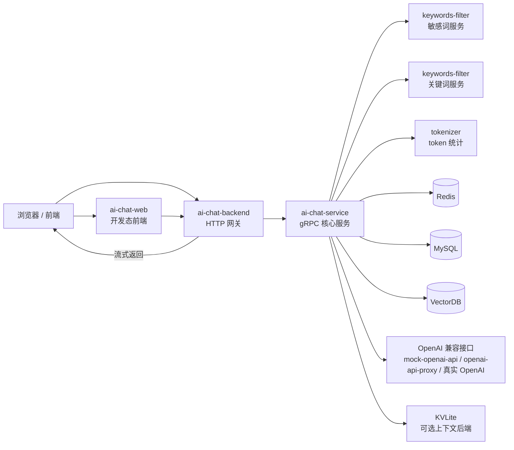

# ai-chat 项目启动与 Docker 指南

这份文档按“先看整体链路，再看逐服务启动，再看 Docker 部署”的顺序整理，目标是让你能从零把整个项目跑起来，并知道每个服务到底依赖什么配置。

适用范围：

- [ai-chat-backend](../ai-chat-backend)
- [ai-chat-service](../ai-chat-service)
- [keywords-filter](../keywords-filter)
- [tokenizer](../tokenizer)
- [openai-api-proxy](../openai-api-proxy)
- [mock-openai-api](../mock-openai-api)
- [ai-chat-web](../ai-chat-web)
- [KVLite](../KVLite)

## 1. 项目整体链路

这个仓库不是单体应用，而是一组独立服务拼出来的聊天系统。主链路可以概括成：



### 1.1 各服务职责

- [ai-chat-backend](../ai-chat-backend)：对外 HTTP 网关，接前端请求，把 `/api/chat-process` 转成 gRPC 调用，再把流式结果转回前端。
- [ai-chat-service](../ai-chat-service)：核心聊天编排服务，负责上下文、过滤、模型调用、落库和向量检索。
- [keywords-filter](../keywords-filter)：提供敏感词/关键词能力，部署时通常起两个实例，分别承担敏感词和关键词服务。
- [tokenizer](../tokenizer)：按模型计算 token 数，用于控制上下文长度。
- [mock-openai-api](../mock-openai-api)：本地假 OpenAI 接口，便于离线调试。
- [openai-api-proxy](../openai-api-proxy)：OpenAI 兼容代理，适合把上游请求转发到真实 OpenAI 或其他兼容服务。
- [ai-chat-web](../ai-chat-web)：独立前端工程，适合开发态；后端服务本身也会从 `www/` 目录提供静态页面。
- [KVLite](../KVLite)：可选的上下文后端，不是默认主路径，只有把 `context_backend` 切到 `kvlite` 时才需要启动。

### 1.2 主请求流

一次聊天请求的大致路径是：

1. 浏览器发起请求，通常先进入 `ai-chat-web`，或者直接打到 `ai-chat-backend`。
2. `ai-chat-backend` 接收 `/api/chat-process`，把请求包装成 gRPC 调用，转给 `ai-chat-service`。
3. `ai-chat-service` 先做敏感词/关键词处理，再结合上下文、Redis/MySQL/VectorDB 和 OpenAI 兼容接口生成结果。
4. 结果会以流式方式返回给 `ai-chat-backend`，再继续流式转给前端。
5. `ai-chat-service` 的回答主流程是先返回流，再把 Redis / MySQL / VectorDB 的写入放到异步路径里做。

## 2. 建议的启动顺序

建议按下面顺序启动，避免“服务起来了，但上游依赖还没准备好”的假成功。

### 2.1 先准备外部依赖

先确认这些依赖可用：

- Redis
- MySQL
- VectorDB
- OpenAI 兼容接口

如果你要启用 KVLite，再额外启动：

- KVLite 主节点，默认 `9300`
- 如有需要，再启动 KVLite 从节点

### 2.2 再启动支撑服务

| 服务 | 默认端口 | 启动方式 | 关键配置 |
|---|---:|---|---|
| tokenizer | 3002 | `nuxt --port 3002 --module tokenizer.py --workers 2` | 环境变量 `PORT=3002` |
| keywords-filter（敏感词） | 50053 | `go run ./filter-server --config=dev.config.yaml --dict=dict.txt` | `server.port=50053`、`server.accessToken`、`dict.txt` |
| keywords-filter（关键词） | 50054 | `go run ./filter-server --config=dev.kw.config.yaml --dict=keyword-dict.txt` | `server.port=50054`、`server.accessToken`、关键词字典 |
| mock-openai-api | 8083 | `go run . --config=dev.config.yaml` | `http.port=8083`、`http.access_token` |
| openai-api-proxy | 8084 | `go run . --config=dev.config.yaml` | `chat.api_keys`、`chat.base_url`、`http.access_token` |

### 2.3 再启动核心服务

| 服务 | 默认端口 | 启动方式 | 关键配置 |
|---|---:|---|---|
| ai-chat-service | 50055 | `go run ./chat-server --config=dev.config.yaml` | `server.port`、`server.accessToken`、`chat.base_url`、`redis`、`mysql`、`dependOn.*` |
| ai-chat-backend | 7080 | `go run ./cmd --config=dev.config.yaml` | `http.port`、`dependOn.ai-chat-service.address`、`accessToken` |
| ai-chat-web | 1002 | `pnpm bootstrap && pnpm dev` | `.env.develop` 里的 `VITE_APP_API_BASE_URL` |

### 2.4 如果启用 KVLite

| 服务 | 默认端口 | 启动方式 | 关键配置 |
|---|---:|---|---|
| KVLite master | 9300 | `make && ./kvstore --config config/master.conf` | `role=master`、`port=9300` |
| KVLite slave | 8081（示例） | `./kvstore --config config/slave.conf` | `role=slave`、`master_ip`、`master_port` |

如果 `ai-chat-service` 仍然使用 Redis 作为上下文后端，那么 KVLite 可以不启动。只有把 `context_backend` 切到 `kvlite` 时，才需要它真正进入链路。

## 3. 逐服务启动说明

### 3.1 tokenizer

文件参考： [tokenizer/README.md](../tokenizer/README.md) 、 [tokenizer/Dockerfile](../tokenizer/Dockerfile)

这个服务只负责 token 统计，`ai-chat-service` 会拿它来估算上下文长度。

最关键的配置只有一个：端口 3002。仓库里给出的 Docker/compose 启动命令是：

```bash
nuxt --port 3002 --module tokenizer.py --workers 2
```

容器镜像里通过环境变量 `PORT=3002` 传入端口。

### 3.2 keywords-filter

文件参考： [keywords-filter/filter-server/main.go](../keywords-filter/filter-server/main.go) 、 [keywords-filter/dev.config.yaml](../keywords-filter/dev.config.yaml) 、 [keywords-filter/dev.kw.config.yaml](../keywords-filter/dev.kw.config.yaml)

这个服务是 gRPC 服务，启动时会读取：

- `--config`：服务配置文件
- `--dict`：字典文件

两个常见实例分别是：

- 敏感词服务：`dev.config.yaml`，端口 `50053`
- 关键词服务：`dev.kw.config.yaml`，端口 `50054`

两个实例都要保证：

- `server.accessToken` 和调用方一致
- 字典文件路径正确
- 端口没有冲突

启动命令示例：

```bash
go run ./filter-server --config=dev.config.yaml --dict=dict.txt
go run ./filter-server --config=dev.kw.config.yaml --dict=dict.txt
```

如果你需要重新格式化字典，入口里还有 `--format` 参数，但它不是正常启动路径的一部分。

### 3.3 mock-openai-api

文件参考： [mock-openai-api/main.go](../mock-openai-api/main.go) 、 [mock-openai-api/dev.config.yaml](../mock-openai-api/dev.config.yaml) 、 [mock-openai-api/README.md](../mock-openai-api/README.md)

这个服务用于本地离线联调，提供 OpenAI 兼容接口。当前代码和 Dockerfile 里默认端口是 `8083`，以 `dev.config.yaml` 为准。

关键配置：

- `http.host=0.0.0.0`
- `http.port=8083`
- `http.access_token` 要和上游调用方保持一致
- `http.mode=debug`

启动命令：

```bash
go run . --config=dev.config.yaml
```

注意：仓库里的 README 旧示例写的是 `8082`，但当前配置文件和 Dockerfile 对应的是 `8083`。

### 3.4 openai-api-proxy

文件参考： [openai-api-proxy/main.go](../openai-api-proxy/main.go) 、 [openai-api-proxy/dev.config.yaml](../openai-api-proxy/dev.config.yaml) 、 [openai-api-proxy/README.md](../openai-api-proxy/README.md)

这个服务是 OpenAI 兼容代理，适合把请求转到真实 OpenAI 或其他兼容上游。当前 `dev.config.yaml` 默认端口是 `8084`。

关键配置：

- `http.port=8084`
- `http.access_token` 用于代理层鉴权
- `chat.api_keys` 作为上游 key 列表
- `chat.base_url` 是上游接口地址

启动命令：

```bash
go run . --config=dev.config.yaml
```

注意：仓库里的 README 部署示例里有旧端口 `4002`，但当前配置文件对应的是 `8084`，以配置文件为准。

### 3.5 ai-chat-service

文件参考： [ai-chat-service/chat-server/main.go](../ai-chat-service/chat-server/main.go) 、 [ai-chat-service/dev.config.yaml](../ai-chat-service/dev.config.yaml) 、 [ai-chat-service/pkg/config/config.go](../ai-chat-service/pkg/config/config.go)

这是整个系统的核心服务，负责：

- 接收来自 `ai-chat-backend` 的 gRPC 请求
- 做上下文判断和流式生成
- 调用 tokenizer、keywords-filter、OpenAI 兼容接口
- 把聊天记录写回 Redis / MySQL / VectorDB

默认配置里最重要的字段是：

- `server.port=50055`
- `server.accessToken` 必须和后端一致
- `chat.api_key` 要能通过你配置的 OpenAI 兼容接口鉴权
- `chat.base_url=http://localhost:8084/v1`，表示默认会走 `openai-api-proxy`
- `dependOn.sensitive.address`、`dependOn.keywords.address`、`dependOn.tokenizer.address`
- `redis`、`mysql`、`vectorDB`

如果你要切换到 KVLite，需要改：

- `context.context_backend=kvlite`
- `context.context_fallback_to_redis=true|false`
- `context.kvlite.addr`

启动命令：

```bash
go run ./chat-server --config=dev.config.yaml
```

服务启动后还会额外暴露 `8080/metrics`，用于 Prometheus 采集。

### 3.6 ai-chat-backend

文件参考： [ai-chat-backend/cmd/main.go](../ai-chat-backend/cmd/main.go) 、 [ai-chat-backend/dev.config.yaml](../ai-chat-backend/dev.config.yaml) 、 [ai-chat-backend/pkg/controllers/chat.go](../ai-chat-backend/pkg/controllers/chat.go)

这是对外 HTTP 网关，主要职责是把前端请求转成 `ai-chat-service` 的 gRPC 流式调用。

默认配置里最重要的字段是：

- `http.port=7080`
- `dependOn.ai-chat-service.address=localhost:50055`
- `dependOn.ai-chat-service.accessToken` 必须和 `ai-chat-service.server.accessToken` 保持一致

启动命令：

```bash
go run ./cmd --config=dev.config.yaml
```

这个服务还会从 `www/` 目录提供静态页面，所以如果你不想单独起 `ai-chat-web`，直接访问 `http://localhost:7080/` 也可以。

### 3.7 ai-chat-web

文件参考： [ai-chat-web/README_0voice.md](../ai-chat-web/README_0voice.md) 、 [ai-chat-web/.env.develop](../ai-chat-web/.env.develop) 、 [ai-chat-web/vite.config.ts](../ai-chat-web/vite.config.ts) 、 [ai-chat-web/Dockerfile](../ai-chat-web/Dockerfile)

这是独立前端工程，适合开发态使用。

关键配置：

- `VITE_APP_API_BASE_URL=http://localhost:7080/`
- `VITE_GLOB_API_URL=/api`
- `VITE_USER_CENTER=http://localhost:8082?sys=ai`
- Vite 开发端口是 `1002`

启动命令：

```bash
pnpm bootstrap
pnpm dev
```

如果只是验证后端链路，也可以直接跳过这个工程，使用 `ai-chat-backend` 自带的静态页面。

### 3.8 KVLite

文件参考： [KVLite/README.md](../KVLite/README.md) 、 [KVLite/config/master.conf](../KVLite/config/master.conf) 、 [KVLite/config/slave.conf](../KVLite/config/slave.conf)

KVLite 是可选的上下文后端，不是默认主路径。当前 `ai-chat-service` 默认还是 Redis，只有切换 `context_backend=kvlite` 时才需要把它启动起来。

启动步骤：

```bash
cd KVLite
git submodule init
git submodule update
make
./kvstore --config config/master.conf
```

如果你要做主从测试，再启动一个从节点：

```bash
./kvstore --config config/slave.conf
```

默认主节点端口是 `9300`，`ai-chat-service` 里的 `context.kvlite.addr` 也应该指向这个地址。

## 4. Docker / Swarm 部署指南

### 4.1 先说明一个关键点

[ai-chat-stack/compose.yaml](../ai-chat-stack/compose.yaml) 不是普通的轻量 `docker compose` 文件，而是偏 Docker Swarm 的编排文件，因为它用到了：

- `deploy`
- `configs`
- `healthcheck`

如果你只是执行 `docker compose up`，这些能力不一定都按预期生效。更稳妥的方式是用 `docker stack deploy`。

### 4.2 推荐的 Swarm 部署流程

1. 初始化 Swarm：

```bash
docker swarm init
```

2. 构建并推送镜像到仓库中配置的镜像源，仓库里的默认镜像前缀是 `192.168.239.161:5000/2404/...`。

3. 部署栈：

```bash
docker stack deploy -c ai-chat-stack/compose.yaml ai-chat
```

4. 查看服务状态：

```bash
docker service ls
docker service ps ai-chat_ai-chat-backend
docker service logs -f ai-chat_ai-chat-service
```

### 4.3 `ai-chat-stack/compose.yaml` 实际包含哪些服务

这个文件里只编排了：

- tokenizer
- keywords
- sensitive
- ai-chat-service
- ai-chat-backend

它没有把下面这些一起纳入：

- mock-openai-api
- openai-api-proxy
- Redis
- MySQL
- VectorDB

所以如果你想把整个系统完全跑通，这些外部依赖仍然需要你自己补齐，或者改成可访问的真实地址。

### 4.4 Dockerfile 对应关系

每个服务基本都已经提供了 Dockerfile：

- [ai-chat-backend/Dockerfile](../ai-chat-backend/Dockerfile)
- [ai-chat-service/Dockerfile](../ai-chat-service/Dockerfile)
- [keywords-filter/Dockerfile](../keywords-filter/Dockerfile)
- [tokenizer/Dockerfile](../tokenizer/Dockerfile)
- [mock-openai-api/Dockerfile](../mock-openai-api/Dockerfile)
- [openai-api-proxy/Dockerfile](../openai-api-proxy/Dockerfile)
- [ai-chat-web/Dockerfile](../ai-chat-web/Dockerfile)

这些 Dockerfile 的共同点是：

- 构建阶段负责编译 Go 程序或前端静态资源
- 运行阶段把 `dev.config.yaml` 拷进容器，统一命名为 `/app/config.yaml`
- 启动时通过 `--config=config.yaml` 读取配置

### 4.5 各服务的 Docker 启动要点

- tokenizer：镜像启动后直接按 `nuxt --port 3002 --module tokenizer.py --workers 2` 跑。
- keywords-filter：容器里会执行 `./keywords-filter --config=config.yaml --dict=dict.txt`。
- ai-chat-service：容器里会执行 `./ai-chat-service --config=config.yaml`。
- ai-chat-backend：容器里会执行 `./ai-chat-backend --config=config.yaml`。
- mock-openai-api：容器里会执行 `./mock-openai-api --config=config.yaml`。
- openai-api-proxy：容器里会执行 `./openai-api-proxy --config=config.yaml`。
- ai-chat-web：构建后把 `dist/` 交给 nginx 直接托管。

### 4.6 一个很重要的容器内地址问题

`ai-chat-service` 的默认配置里，`chat.base_url` 指向的是 `http://localhost:8084/v1`。

这在“本机直接跑进程”的场景里没问题，因为 `openai-api-proxy` 就在本机上；但在容器里，`localhost` 只代表容器自己。也就是说：

- 如果你用容器单独跑 `ai-chat-service`，它不一定能直接访问到宿主机上别的容器。
- 如果你用 `ai-chat-stack/compose.yaml`，还需要额外把 OpenAI 兼容服务放到一个容器网络里，并把地址改成容器可达的主机名或服务名。

这也是这套部署里最容易踩坑的地方。

## 5. 配置文件速查

### 5.1 关键配置一览

| 文件 | 作用 | 必看字段 |
|---|---|---|
| [ai-chat-backend/dev.config.yaml](../ai-chat-backend/dev.config.yaml) | HTTP 网关配置 | `http.port`、`dependOn.ai-chat-service.address`、`dependOn.ai-chat-service.accessToken` |
| [ai-chat-service/dev.config.yaml](../ai-chat-service/dev.config.yaml) | 核心 gRPC 服务配置 | `server.port`、`chat.base_url`、`redis`、`mysql`、`dependOn.*`、`context.*` |
| [ai-chat-stack/configs/ai-chat-service.yaml](../ai-chat-stack/configs/ai-chat-service.yaml) | Swarm 部署版核心服务配置 | 同上，但地址改成容器服务名 |
| [keywords-filter/dev.config.yaml](../keywords-filter/dev.config.yaml) | 敏感词服务配置 | `server.port=50053`、`server.accessToken` |
| [keywords-filter/dev.kw.config.yaml](../keywords-filter/dev.kw.config.yaml) | 关键词服务配置 | `server.port=50054`、`server.accessToken` |
| [mock-openai-api/dev.config.yaml](../mock-openai-api/dev.config.yaml) | 本地 OpenAI Mock 配置 | `http.port=8083`、`http.access_token` |
| [openai-api-proxy/dev.config.yaml](../openai-api-proxy/dev.config.yaml) | OpenAI 代理配置 | `http.port=8084`、`chat.api_keys`、`chat.base_url` |
| [ai-chat-web/.env.develop](../ai-chat-web/.env.develop) | 前端开发配置 | `VITE_APP_API_BASE_URL`、`VITE_USER_CENTER` |
| [KVLite/config/master.conf](../KVLite/config/master.conf) | KVLite 主节点配置 | `port=9300`、`role=master` |
| [KVLite/config/slave.conf](../KVLite/config/slave.conf) | KVLite 从节点配置 | `role=slave`、`master_ip`、`master_port` |

### 5.2 三组最容易错的匹配关系

- `ai-chat-backend` 的 `dependOn.ai-chat-service.accessToken` 必须和 `ai-chat-service.server.accessToken` 一致。
- `ai-chat-service` 访问 `keywords-filter` 时，`dependOn.sensitive.accessToken` / `dependOn.keywords.accessToken` 必须和两个过滤服务的 `server.accessToken` 一致。
- `ai-chat-service.chat.api_key` 要和你实际部署的 OpenAI 兼容服务接受的 key 一致；如果走本地链路，通常要和 mock/proxy 的 token 配套。

## 6. 常见问题

### 6.1 端口描述有旧值

仓库里有些 README 里的端口是旧示例，最明显的是：

- `mock-openai-api`：README 里有 `8082`，但当前 `dev.config.yaml` 是 `8083`
- `openai-api-proxy`：README 里有 `4002`，但当前 `dev.config.yaml` 是 `8084`

实际启动时优先看配置文件，不要直接照 README 旧端口抄。

### 6.2 `compose.yaml` 不是完整全家桶

`ai-chat-stack/compose.yaml` 只管核心链路里的几个服务，没有把 Redis、MySQL、VectorDB、OpenAI 兼容服务一起编进去。所以它更像“核心业务栈”，不是“一键全量环境”。

### 6.3 backend 和 web 的关系

`ai-chat-backend` 已经能直接提供静态页面，所以它不是只能做 API 网关；`ai-chat-web` 则是独立前端工程，适合你开发 UI 时单独跑。

### 6.4 KVLite 是可选项

当前主线默认还是 Redis。只有你明确要测 `context_backend=kvlite`，KVLite 才进入必需项。

## 7. 最后建议

如果你的目标是“最快把项目跑起来”，推荐顺序是：

1. 先起 Redis、MySQL、VectorDB 和 OpenAI 兼容接口
2. 再起 tokenizer、keywords-filter、ai-chat-service
3. 再起 ai-chat-backend
4. 最后起 ai-chat-web 或直接访问后端静态页

如果你的目标是“看懂整个系统”，先读这三个入口就够了：

- [ai-chat-backend/cmd/main.go](../ai-chat-backend/cmd/main.go)
- [ai-chat-backend/pkg/controllers/chat.go](../ai-chat-backend/pkg/controllers/chat.go)
- [ai-chat-service/chat-server/main.go](../ai-chat-service/chat-server/main.go)
