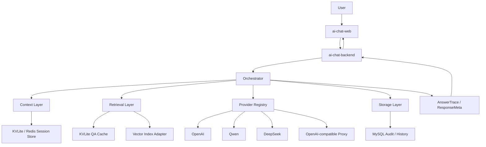

# 多模型 AI-chat + KVLite 语义检索演进方案

本方案以当前仓库真实实现为基线，目标不是把项目一次性做成完整平台，而是沿着“最小正确演进”把系统升级成一个可解释、可缓存、可检索、可展示来源的多模型 AI-chat 系统。

当前仓库已经具备 OpenAI-compatible 调用链、流式响应、session/context 存储、KVLite 兼容层、MySQL 落库、关键词/向量外部索引和前端流式渲染基础；缺的是统一 provider 抽象、回答路由策略、QARecord 级别的本地知识缓存、真正的语义检索、以及面向前端的来源解释字段。

---

## 1. 当前仓库现状扫描

### 1.1 真实链路

当前主链路可以概括为：

用户在 [ai-chat-web/src/views/chat/index.vue](../ai-chat-web/src/views/chat/index.vue) 发起请求 -> [ai-chat-backend/pkg/controllers/chat.go](../ai-chat-backend/pkg/controllers/chat.go) 将 HTTP 请求转成 gRPC -> [ai-chat-service/chat-server/server/server.go](../ai-chat-service/chat-server/server/server.go) 调用模型并写回上下文 -> 前端继续用分块 JSON 的方式渲染。

目前还存在一条辅助链路：[openai-api-proxy/proxy/proxy.go](../openai-api-proxy/proxy/proxy.go) 会把请求反向代理到 OpenAI-compatible 上游；[mock-openai-api/main.go](../mock-openai-api/main.go) 用于模拟 provider。

### 1.2 当前已经具备的能力

- OpenAI-compatible 调用链已经存在，核心服务通过 `go-openai` 的 `base_url + api_key` 方式接入模型，见 [ai-chat-service/chat-server/server/app.go](../ai-chat-service/chat-server/server/app.go)。
- 流式输出已经贯通，service 返回 gRPC stream，backend 再转成 HTTP chunk，前端按行解析 JSON。
- session/context 已经不是纯临时变量，`TurnRecord`、`SessionMeta`、`SummaryRecord`、`StoreSummary`、`LoadSummary` 都已经定义在 [ai-chat-service/chat-server/chat-context/session.go](../ai-chat-service/chat-server/chat-context/session.go) 和 [ai-chat-service/chat-server/chat-context/backend.go](../ai-chat-service/chat-server/chat-context/backend.go)。
- KVLite 不是“硬拼一个 wrapper”，而是通过 `rawBackend`、`kvliteConnPool`、`BatchWrite`、fallback、shadow read、repair 等机制，已经形成了可用的上下文存储层，见 [ai-chat-service/chat-server/chat-context/backend.go](../ai-chat-service/chat-server/chat-context/backend.go) 与 [ai-chat-service/chat-server/chat-context/factory.go](../ai-chat-service/chat-server/chat-context/factory.go)。
- MySQL 负责当前聊天记录的持久化，见 [ai-chat-service/chat-server/data/chat_records.go](../ai-chat-service/chat-server/data/chat_records.go)。
- 外部向量/检索能力已经有一个雏形，但当前实现是“关键词文本搜索”而不是“语义向量检索”，见 [ai-chat-service/chat-server/vector-data/chat_records.go](../ai-chat-service/chat-server/vector-data/chat_records.go)。
- 前端已经能渲染流式回答，并支持继续长回复、重新生成和上下文切换，见 [ai-chat-web/src/views/chat/index.vue](../ai-chat-web/src/views/chat/index.vue) 和 [ai-chat-web/src/store/modules/chat/index.ts](../ai-chat-web/src/store/modules/chat/index.ts)。

### 1.3 当前最关键的缺口

- 当前只有单一 OpenAI-compatible 调用链，没有 provider registry，也没有 provider/model profile。
- 当前回答缓存不是 QARecord，而是“关键词命中后直接返回历史答案”，语义层和来源层都太弱。
- 当前 `vector-data` 的检索是 `SearchByText`，并不是基于 embedding 的语义检索。
- 当前响应 schema 只有 `id/sessionId/text/detail` 这类基础字段，没有 answer trace、retrieval hits、provider/model 元信息。
- 当前前端读的是 `conversationId`，而后端实际返回的是 `sessionId`；`parentMessageId` 负责续链，`conversationId` 只是历史兼容字段。
- 当前 `ai-chat-backend` 到 `ai-chat-service` 的 gRPC 调用使用的是 `context.Background()`，HTTP 取消语义没有完整传下去。
- 当前 tokenizer 只覆盖少数 OpenAI 模型名，对 Qwen/DeepSeek 不友好，见 [ai-chat-backend/tokenizer.py](../ai-chat-backend/tokenizer.py)。

### 1.4 现在的系统本质是什么

它不是纯聊天 Demo，也还不是完整 RAG 平台。更准确地说，它已经是一个“带会话上下文缓存的 OpenAI-compatible AI-chat 服务”，并且具备演进为“LLM middleware / gateway + 本地问答缓存 + 语义检索”的基础。

---

## 2. 与最终目标的差距

| 能力 | 当前状态 | 最终目标 | 差距 |
|---|---|---|---|
| 多 Provider 接入 | 单一 OpenAI-compatible 调用链 | OpenAI / Qwen / DeepSeek 统一接入 | 缺 provider registry、profile、能力矩阵 |
| 路由策略 | 仅关键词命中后直返，否则直接调用模型 | API_ONLY / LOCAL_ONLY / HYBRID / CACHE_HIT_RETURN | 缺 query policy 与路由器 |
| 本地问答缓存 | 只有 chat_records + 关键词索引 | QARecord、规范化问题索引、session-turn 映射、trace | 数据模型太弱 |
| 语义检索 | `SearchByText` 关键词检索 | embedding + vector retrieval + rerank | 还不是真正语义检索 |
| 来源展示 | 前端只有文本和 finish_reason | answer_mode/provider/model/hits/similarity | schema 和 UI 都缺字段 |
| 上下文体系 | session / recent turns / summary 骨架存在 | summary + recent turns + retrieval hits 协同 | summary 未真正闭环 |
| 取消传播 | 后端使用 `context.Background()` | HTTP -> gRPC -> provider 全链路可取消 | 需要重构 |
| 可观测性 | 有部分 metrics | provider/model/route/hit/trace 全链路观测 | 指标粒度不够 |

---

## 3. 总体架构设计

### 3.1 分层目标

建议把系统收敛成六层：

1. Provider Layer：OpenAI / Qwen / DeepSeek 统一适配。
2. Orchestrator Layer：查询路由、降级、重试、结果归档。
3. Context Layer：session / summary / recent turns。
4. Retrieval Layer：本地缓存命中、语义检索、命中标准化。
5. Storage Layer：KVLite、Redis、MySQL、向量索引各自职责明确。
6. Frontend Presentation Layer：来源解释、provider/model、命中结果展示。

### 3.2 架构图



### 3.3 关键设计原则

- Provider 只负责生成和 embedding，不负责路由和缓存。
- Orchestrator 只负责决策和编排，不直接写散落的业务 if/else。
- Context 只管会话连续性，不管知识沉淀。
- Retrieval 只管找到“可用证据”，不直接改写会话历史。
- Storage 分层要清楚：Redis 处理热上下文，KVLite 处理本地问答缓存和 session 存储，MySQL 处理审计和历史，向量索引处理近邻召回。
- Frontend 只消费结构化 trace，不从 answer 文本里反推来源。

### 3.4 Provider Layer 建议接口

```go
type Provider interface {
    Name() string
    Capabilities() CapabilitySet
    Chat(ctx context.Context, req ChatRequest) (*ChatResult, error)
    ChatStream(ctx context.Context, req ChatRequest) (ChatStream, error)
}

type EmbeddingProvider interface {
    Name() string
    Embed(ctx context.Context, texts []string) ([][]float32, error)
}

type ProviderProfile struct {
    ProviderName          string
    Kind                  string
    BaseURL               string
    APIKey                string
    DefaultChatModel      string
    DefaultEmbeddingModel string
    SupportsStream        bool
    SupportsNonStream     bool
    SupportsEmbedding     bool
    ModelAliases          map[string]string
    ExtraHeaders          map[string]string
}
```

Provider 差异要收敛到 adapter / profile 层，业务主流程只拿 `provider_name + model_name + capability`。

### 3.5 Orchestrator Layer 职责

- 决定走 API_ONLY、LOCAL_ONLY、HYBRID_RAG_STYLE、CACHE_HIT_RETURN 哪条路径。
- 根据 provider 可用性、模型配置、阈值、用户配置进行路由。
- 统一组装 prompt 和 answer trace。
- 统一做 fallback / retry / fallback provider。
- 统一做成功回答的归档写入。

### 3.6 Context Layer 职责

当前已有的 `SessionStore`、`TurnRecord`、`SessionMeta`、`SummaryRecord` 应该继续保留，但要明确它们只负责会话连续性。

### 3.7 Retrieval Layer 职责

Retrieval Layer 不等于聊天历史回放，它负责的是：

- exact cache lookup。
- normalized question lookup。
- semantic retrieval。
- hit 标准化。
- 证据片段预览和相似度解释。

### 3.8 Storage Layer 职责边界

- Redis：session hot cache、临时锁、短期状态。
- KVLite：本地 QARecord、session-turn 记录、norm index、vector blob 或 vector ref。
- MySQL：全量聊天审计、报表、运营查询。
- 向量索引：近邻搜索，不要求 KVLite 第一版直接承担 ANN。

### 3.9 Frontend Presentation Layer 职责

前端只做展示，不做路由决策。它需要能展示：

- answer_mode
- provider / model
- retrieved_records
- similarity_scores
- final_answer_source
- cache_hit
- 是否使用本地检索增强

### 3.10 Provider / embedding 配置建议

建议配置不要再只保留单个 `chat.model`，而是引入 profile 列表，例如：

```yaml
providers:
  - name: openai
    kind: openai-compatible
    base_url: https://api.openai.com/v1
    api_key: xxx
    chat_model: gpt-4o-mini
    embedding_model: text-embedding-3-small
  - name: qwen
    kind: openai-compatible
    base_url: https://dashscope.aliyuncs.com/compatible-mode/v1
    api_key: xxx
    chat_model: qwen-flash
    models:
      - qwen-flash
      - qwen-plus
    embedding_model: text-embedding-v3
  - name: deepseek
    kind: openai-compatible
    base_url: https://api.deepseek.com/v1
    api_key: xxx
    chat_model: deepseek-chat
    embedding_model: text-embedding-3-small
```

---

## 4. 数据模型设计

### 4.1 QARecord

建议把“对话沉淀”从纯字符串升级成结构化记录。下面是推荐的核心结构：

```go
type QARecord struct {
    RecordID           string            `json:"record_id"`
    SessionID          string            `json:"session_id"`
    TurnSeq            int64             `json:"turn_seq"`
    RequestMessageID    string            `json:"request_message_id,omitempty"`
    ParentMessageID     string            `json:"parent_message_id,omitempty"`
    Question           string            `json:"question"`
    NormalizedQuestion string            `json:"normalized_question"`
    QuestionHash       string            `json:"question_hash"`
    Answer             string            `json:"answer"`
    AnswerSummary      string            `json:"answer_summary,omitempty"`
    SourceType         string            `json:"source_type"`
    Provider           string            `json:"provider"`
    Model              string            `json:"model"`
    EmbeddingModel     string            `json:"embedding_model,omitempty"`
    EmbeddingStatus    string            `json:"embedding_status"`
    SimilarityScore    float64           `json:"similarity_score,omitempty"`
    OriginRecordID     string            `json:"origin_record_id,omitempty"`
    RetrievedHits      []RetrievalHit     `json:"retrieved_hits,omitempty"`
    Metadata           map[string]string `json:"metadata,omitempty"`
    CreatedAt          int64             `json:"created_at"`
    UpdatedAt          int64             `json:"updated_at"`
    ExpiresAt          int64             `json:"expires_at,omitempty"`
}
```

#### 设计说明

- `source_type` 描述“这个记录是怎么来的”，例如 api / local / hybrid / cache_hit。
- `answer_mode` 属于 query-time 的路由结果，不建议塞进 `QARecord` 作为唯一语义；但可以在 `metadata` 中保存一份，以便回放。
- `origin_record_id` 用于 cache_hit 这类派生记录，避免把原始生成记录和本次命中结果混为一谈。
- `SimilarityScore` 在持久化时可以为空，查询态或者 trace 态再填充。
- `EmbeddingStatus` 建议使用 `pending / ready / failed / stale`。

### 4.2 RetrievalHit

```go
type RetrievalHit struct {
    RecordID        string  `json:"record_id"`
    Score           float64 `json:"score"`
    HitType         string  `json:"hit_type"`
    QuestionPreview string  `json:"question_preview"`
    AnswerPreview   string  `json:"answer_preview"`
    Provider        string  `json:"provider"`
    Model           string  `json:"model"`
    SessionID       string  `json:"session_id,omitempty"`
    TurnSeq         int64   `json:"turn_seq,omitempty"`
    SourceType      string  `json:"source_type,omitempty"`
}
```

#### 建议的 hit_type

- exact_norm_hit
- exact_session_hit
- semantic_hit
- rerank_hit
- fallback_hit

### 4.3 AnswerTrace / ResponseMeta

```go
type AnswerTrace struct {
    AnswerMode         string         `json:"answer_mode"`
    Provider           string         `json:"provider"`
    Model              string         `json:"model"`
    UsedLocalRetrieval bool           `json:"used_local_retrieval"`
    RetrievedHits      []RetrievalHit `json:"retrieved_hits,omitempty"`
    CacheHit           bool           `json:"cache_hit"`
    GenerationProvider string         `json:"generation_provider,omitempty"`
    GenerationModel    string         `json:"generation_model,omitempty"`
    FinalAnswerSource  string         `json:"final_answer_source"`
    PolicyVersion      string         `json:"policy_version,omitempty"`
    DecisionReason     string         `json:"decision_reason,omitempty"`
}
```

#### 语义区分

- `provider / model`：这次最终回答使用了什么。
- `generation_provider / generation_model`：如果走了 LLM 生成，这个字段保留生成端信息。
- `final_answer_source`：最终答案到底来自 cache / local_retrieval / llm / hybrid。

### 4.4 QueryPolicy / RouteDecision

```go
type QueryPolicy struct {
    Mode                  string  `json:"mode"`
    ShouldCallLLM         bool    `json:"should_call_llm"`
    ShouldQueryLocal      bool    `json:"should_query_local"`
    UseRetrievalAsContext bool    `json:"use_retrieval_as_context"`
    DirectReturnLocal     bool    `json:"direct_return_local"`
    Threshold             float64 `json:"threshold"`
    Scope                 string  `json:"scope,omitempty"`
    Reason                string  `json:"reason,omitempty"`
}
```

### 4.5 推荐 key 设计

建议把 KVLite 里的 key 拆成四类：

- `qa:{record_id}`：完整 QARecord JSON。
- `qnorm:{hash}`：规范化问题索引，值建议是 JSON 化的候选 record_id 列表或候选索引对象，而不是单个 answer。
- `sess:{session_id}:turn:{seq}`：session-turn 映射，存 turn snapshot 或 record_id。
- `vec:{record_id}`：embedding 向量或向量引用。
- `trace:{record_id}`：可选，存大体量 answer trace / retrieval evidence。

#### 为什么不能只做问题 -> 回答

如果只做 `question -> answer`：

- 同一个问题在不同 session 里可能答案不同。
- 同一个问题在不同 provider/model 下可能答案不同。
- 同一个问题在不同上下文里可能需要不同解释。
- 未来无法展示“这个答案来自哪里”，也无法做来源追踪。
- 语义检索时会丢失 provider / model / turn / session 的 provenance。

所以更合理的设计是：问题索引指向“候选记录集合”，而不是指向唯一答案。

---

## 5. Query Routing / Answer Policy 设计

### 5.1 路由优先级

建议路由顺序固定为：

1. 用户显式策略覆盖。
2. 精确规范化命中。
3. 高置信语义命中。
4. Hybrid RAG。
5. API_ONLY 生成。

### 5.2 四种模式

| Mode | 触发条件 | 动作 |
|---|---|---|
| API_ONLY | 用户要求实时生成、缓存未命中、或问题明显需要生成式回答 | 直接调用 LLM |
| LOCAL_ONLY | 用户明确要求只用本地知识，或业务策略要求仅本地回答 | 只查本地缓存/检索，不调用 LLM |
| HYBRID_RAG_STYLE | 有较高相关的本地记录，但还不足以直接返回 | 先检索，再把结果作为上下文交给 LLM |
| CACHE_HIT_RETURN | 规范化问题精确命中，且记录可信、稳定、未过期 | 直接返回本地答案 |

### 5.3 阈值建议

建议把阈值分成三段，初始值可以先保守：

- `score >= 0.95`：可以考虑直接返回，但必须满足记录可信、稳定、同 scope。
- `0.80 <= score < 0.95`：建议走 HYBRID_RAG_STYLE。
- `score < 0.80`：一般不要直接复用，优先 API_ONLY 或只做弱参考。

这些阈值不是固定真理，必须可以通过配置和 benchmark 调整。

### 5.4 什么时候可以直接返回本地答案

只有同时满足下面条件时，才建议 CACHE_HIT_RETURN：

- 规范化问题一致，或者 semantic score 极高。
- 记录状态是 `confirmed`，不是 `pending`。
- 记录没有过期，且没有被人工或自动规则降级。
- 当前问题不是强上下文依赖问题。
- 当前回答不依赖时效性强的外部事实。
- 选中的 scope 正确，例如 `global` 或当前 session scope。

### 5.5 什么时候只能作为上下文参考

只要出现以下任一情况，就不建议直接返回，而应作为上下文参考：

- 相似度高但不是完全匹配。
- 问题明显依赖当前 session 的最近对话。
- 同一问题在不同 provider/model 下曾产生不同答案。
- 记录来源不稳定，或者质量标记不足。
- 命中内容很像“知识片段”，但不是完整可答复答案。

### 5.6 如何避免错误缓存污染

- 只在回答完整结束后写入确认态记录。
- 不把流式中途失败、被 cancel 的答案写成 canonical cache。
- 对 cache-hit 派生记录与原始生成记录做 lineage 关联，不覆盖原记录。
- 记录 `provider/model/policy_version/prompt_fingerprint`。
- 对负反馈或低质量答案降低权重，必要时禁用 direct return。
- 对时效性问题、敏感问题、系统提示问题不做全局缓存。

### 5.7 结合 provider、session、问题类型、用户配置的决策

路由决策不应该只有相似度，还要看：

- provider 是否可用。
- 当前用户或会话是否配置了 `local_only`、`hybrid`、`api_only`。
- 当前问题是不是上下文连续型问题。
- 当前问题是不是需要实时性答案。
- 当前模型/供应商是否适合被用于该类问题。

---

## 6. Provider + KVLite + Retrieval 协同方案

### 6.1 三者关系先分清

1. Session Context：负责“这一轮对话为什么接这一轮对话”。
2. Local QA Cache：负责“之前回答过的知识能不能直接复用”。
3. Semantic Retrieval：负责“从沉淀的问答中找最像的证据”。

这三者不能互相覆盖：

- session context 不能被 QA cache 替代，因为上下文是顺序敏感的。
- QA cache 不能被 session context 替代，因为跨会话知识必须可复用。
- semantic retrieval 不能被 exact cache 替代，因为近似问题需要证据，不一定能直返。

### 6.2 Prompt Builder 的优先级

建议 prompt 组装顺序固定为：

1. system prompt / safety prompt。
2. route policy instructions。
3. session summary。
4. recent turns。
5. retrieved local QA records。
6. current user question。

### 6.3 Token budget 策略

建议把 token budget 分区管理：

- system prompt：固定保留。
- current question：固定保留。
- summary：优先保留，因为它最压缩。
- recent turns：优先于 retrieval hits，除非问题是知识查询而不是上下文续写。
- retrieved hits：默认 topK 3，必要时再缩到 topK 1。

如果 budget 不够，优先缩减 retrieved hits，再缩减旧 turns，最后才考虑 summary。

### 6.4 对什么内容做 embedding 最合适

结论：不要只做 question，也不要直接拿全文 answer 原样做唯一向量。

推荐顺序是：

- 第一版最小可行：`question + answer_summary`。
- 理想版：双向量或混合策略，至少保留 `question_embedding` 和 `qa_embedding`。
- 长答案：按 chunk + summary 做 embedding，而不是直接把超长原文塞进一个向量。

理由很简单：

- 只对 question 做 embedding，会丢掉答案语义。
- 直接对长 answer 做 embedding，会引入噪声且不利于召回。
- question + concise answer summary 最适合作为 Q&A 知识库的语义主体。

### 6.5 embedding 写入应该同步还是异步

结论：应该异步写入。

原因：

- chat 主链路不能被 embedding RPC 阻塞。
- embedding 失败不应该阻断回答返回。
- embedding 通常是低优先级后台任务，允许重试。

最小实现可以先用异步 goroutine + retry wrapper；工程化后建议用 outbox / 任务表 / worker。

### 6.6 embedding 模型是否和生成模型解耦

结论：逻辑上必须解耦，运行时可以复用同一 provider profile。

也就是说：

- chat provider 负责生成。
- embedding provider 负责向量化。
- 二者可以来自同一厂商，但不能绑死在同一个业务对象里。

这样才能同时支持：

- OpenAI 生成 + OpenAI embedding
- Qwen 生成 + 其他 embedding
- DeepSeek 生成 + 独立 embedding 服务

### 6.7 KVLite 是否直接承担向量检索

结论：第一版不建议让 KVLite 直接承担 ANN 向量检索。

更合理的方式是：

- KVLite 存业务对象、session-turn 映射、规范化索引、embedding blob 或引用。
- 独立 RetrievalIndex 负责近邻搜索。
- 当前仓库已有 `vector_data` 包，可以先把它改造成真正的 retrieval adapter，而不是继续做关键词文本搜索。

如果当前环境暂时没有成熟向量索引能力，第一版可以先做：

- KVLite 存 QARecord。
- 外部向量库或本地简化索引负责近邻搜索。
- 低量数据下允许 brute-force cosine 作为 fallback。

### 6.8 第一版最小可行方案

第一版最小可行的目标不是“全量语义检索平台”，而是：

1. 成功回答后写入 QARecord。
2. 规范化问题可做 exact hit。
3. embedding 异步生成。
4. 外部 index / 简化 index 负责 semantic search。
5. route policy 可返回 `cache_hit / local / hybrid / api`。

这比一开始就把 KVLite 改成向量数据库更稳妥。

### 6.9 理想版演进方向

理想版可以逐步走向：

- KVLite 负责本地知识与 session 事实存储。
- 向量索引独立成服务，支持重建、分片、召回评估。
- MySQL 负责审计和运营查询。
- provider registry 支持多厂商模型选择和 embedding profile。
- retrieval 结果带 citation / evidence span / score breakdown。

### 6.10 Prompt 模板建议

```text
System:
...安全与角色说明...

Session Summary:
...压缩摘要...

Recent Turns:
U: ...
A: ...

Retrieved Local QA:
[hit-1 score=0.92 provider=openai model=gpt-4o-mini]
Q: ...
A: ...

Current Question:
...

Instruction:
如果检索结果与最近上下文冲突，优先最近上下文；如果无法确定，明确说明不确定。
```

---

## 7. 前端来源展示方案

### 7.1 最小改造原则

前端不要大改结构，仍然保留现有的：

- 流式 chunk 渲染。
- `Message` 组件。
- `useChatStore` 本地状态。
- `fetchChatAPIProcess` 的现有调用方式。

只需要给响应和状态对象加 trace 字段即可。

### 7.2 后端 response schema 建议

建议 HTTP gateway 直接返回：

```json
{
  "id": "...",
  "sessionId": "...",
  "conversationId": "...",
  "parentMessageId": "...",
  "text": "...",
  "role": "assistant",
  "delta": "...",
  "detail": {...},
  "trace": {
    "answer_mode": "hybrid",
    "provider": "openai",
    "model": "gpt-4o-mini",
    "used_local_retrieval": true,
    "cache_hit": false,
    "retrieved_hits": [...],
    "final_answer_source": "hybrid_llm"
  }
}
```

#### 兼容原则

- `sessionId` 和 `conversationId` 可以同时保留，避免旧前端 / 新前端不兼容。
- `detail` 继续保留 raw provider response，避免一次性打碎旧逻辑。
- `trace` 是新增主字段，前端只消费它，不去猜 text。

### 7.3 前端状态结构建议

建议把 `Chat.Chat` 扩展成：

```ts
interface AnswerTrace {
  answerMode: 'api' | 'local' | 'hybrid' | 'cache_hit'
  provider: string
  model: string
  usedLocalRetrieval: boolean
  cacheHit: boolean
  finalAnswerSource: string
  retrievedHits?: {
    recordId: string
    score: number
    hitType: string
    questionPreview: string
    answerPreview: string
    provider: string
    model: string
  }[]
}

interface Chat {
  dateTime: string
  text: string
  inversion?: boolean
  error?: boolean
  loading?: boolean
  conversationOptions?: ConversationRequest | null
  requestOptions: { prompt: string; options?: ConversationRequest | null }
  trace?: AnswerTrace
}
```

### 7.4 UI 展示最小方案

在 [ai-chat-web/src/views/chat/components/Message/index.vue](../ai-chat-web/src/views/chat/components/Message/index.vue) 下方增加一条轻量来源信息即可：

- `answer_mode: api / local / hybrid / cache_hit`
- `provider / model`
- `cache_hit` 是否命中
- `retrieved_hits` 数量和最高相似度
- 点击展开后显示命中记录摘要

这样用户能直接看到“这次回答从哪来”，但不会影响现有聊天布局。

### 7.5 流式兼容注意事项

当前前端是按换行分隔 JSON chunk 的方式解析 responseText，所以新增 trace 字段时不要轻易改成新的流协议。

最稳妥的做法是：

- 保持一行一个 JSON 对象。
- trace 在最终 chunk 中补齐。
- 前端只在 `data.trace` 存在时更新展示。

---

## 8. 分阶段迭代路线

### Phase 1：统一 Provider 抽象

#### 目标

完成 OpenAI / Qwen / DeepSeek 统一接入，修复 stream / cancel / config 问题。

#### 主要改动文件

- [ai-chat-service/chat-server/server/app.go](../ai-chat-service/chat-server/server/app.go)
- [ai-chat-service/chat-server/server/server.go](../ai-chat-service/chat-server/server/server.go)
- [ai-chat-service/pkg/config/config.go](../ai-chat-service/pkg/config/config.go)
- [ai-chat-backend/pkg/controllers/chat.go](../ai-chat-backend/pkg/controllers/chat.go)
- [ai-chat-backend/pkg/config/config.go](../ai-chat-backend/pkg/config/config.go)
- [ai-chat-backend/tokenizer.py](../ai-chat-backend/tokenizer.py)
- [ai-chat-service/proto/chat.proto](../ai-chat-service/proto/chat.proto)

#### 新增模块

- `ai-chat-service/chat-server/provider/`
- `ai-chat-service/chat-server/provider/profile/`
- `ai-chat-service/chat-server/provider/registry/`

#### 风险点

- 不同 provider 的 stream finish_reason 可能不完全一致。
- Qwen / DeepSeek 的模型名与参数兼容度需要实际验证。
- 当前 backend 取消语义没有传下去，必须先修。

#### 验证方式

- provider registry 单测。
- mock provider 流式测试。
- 取消中断测试。
- config profile 解析测试。

#### 完成后能力

- 能用统一接口接入 OpenAI / Qwen / DeepSeek。
- stream / non-stream 都能走同一条业务编排链。
- provider/model 信息能被 trace 记录。

### Phase 2：本地问答缓存落地

#### 目标

对成功问答写入 KVLite，先把 QARecord 和 metadata 存起来。

#### 主要改动文件

- [ai-chat-service/chat-server/server/server.go](../ai-chat-service/chat-server/server/server.go)
- [ai-chat-service/chat-server/chat-context/backend.go](../ai-chat-service/chat-server/chat-context/backend.go)
- [ai-chat-service/chat-server/chat-context/session.go](../ai-chat-service/chat-server/chat-context/session.go)
- [ai-chat-service/chat-server/chat-context/factory.go](../ai-chat-service/chat-server/chat-context/factory.go)

#### 新增模块

- `ai-chat-service/chat-server/qa/`
- `ai-chat-service/chat-server/qa/store/`

#### 风险点

- 当前保存逻辑是 goroutine 异步写，没有 MQ / outbox，崩溃时可能丢写。
- 需要明确成功回答和失败回答的写入边界。

#### 验证方式

- QARecord 存取测试。
- session-turn 到 record 映射测试。

#### 完成后能力

- 每轮成功对话能沉淀成结构化本地记录。
- 记录包含 provider/model/source 元信息。

### Phase 3：本地精确命中 / 近似缓存命中

#### 目标

相同问题或规范化问题先尝试命中，支持 `cache_hit_return`。

#### 主要改动文件

- [ai-chat-service/chat-server/server/server.go](../ai-chat-service/chat-server/server/server.go)
- [ai-chat-service/chat-server/chat-context/backend.go](../ai-chat-service/chat-server/chat-context/backend.go)
- [ai-chat-service/chat-server/chat-context/factory.go](../ai-chat-service/chat-server/chat-context/factory.go)

#### 新增模块

- `ai-chat-service/chat-server/retrieval/`
- `ai-chat-service/chat-server/retrieval/normalize/`

#### 风险点

- 规范化过强会导致误命中。
- 不同 session / provider / model 之间的答案可能不等价。

#### 验证方式

- normalized question 命中测试。
- cache poisoning 回归测试。

#### 完成后能力

- 能对稳定问题直接返回本地答案。
- 有明确的命中/未命中解释。

### Phase 4：embedding 写入与语义检索 MVP

#### 目标

对 QARecord 做 embedding，支持最小语义检索能力，并输出检索命中结果。

#### 主要改动文件

- [ai-chat-service/chat-server/vector-data/chat_records.go](../ai-chat-service/chat-server/vector-data/chat_records.go)
- [ai-chat-service/chat-server/server/server.go](../ai-chat-service/chat-server/server/server.go)
- [ai-chat-service/chat-server/chat-context/backend.go](../ai-chat-service/chat-server/chat-context/backend.go)

#### 新增模块

- `ai-chat-service/chat-server/embedding/`
- `ai-chat-service/chat-server/retrieval/index/`
- `ai-chat-service/chat-server/retrieval/rerank/`

#### 风险点

- 当前 `vector-data` 只是文本搜索，不是真正 embedding search。
- 如果向量库不可用，需要有 fallback index。

#### 验证方式

- retrieval routing 测试。
- embedding job 的重试测试。
- topK recall 质量评估。

#### 完成后能力

- 能把近似问题召回为证据片段。
- 能区分 exact hit 和 semantic hit。

### Phase 5：Hybrid 问答链路

#### 目标

本地检索结果参与 prompt builder，LLM 基于检索结果增强生成。

#### 主要改动文件

- [ai-chat-service/chat-server/server/app.go](../ai-chat-service/chat-server/server/app.go)
- [ai-chat-service/chat-server/server/server.go](../ai-chat-service/chat-server/server/server.go)
- [ai-chat-service/chat-server/chat-context/backend.go](../ai-chat-service/chat-server/chat-context/backend.go)

#### 新增模块

- `ai-chat-service/chat-server/prompt/`
- `ai-chat-service/chat-server/orchestrator/`

#### 风险点

- prompt 过长导致 token 超限。
- retrieved hits 和 recent turns 顺序不合理会污染回答。

#### 验证方式

- hybrid prompt builder 测试。
- token budget 测试。

#### 完成后能力

- 能把本地知识真正变成上下文增强，而不只是缓存命中。

### Phase 6：前端来源展示

#### 目标

UI 区分 api/local/hybrid/cache_hit，并显示 provider/model/hits。

#### 主要改动文件

- [ai-chat-web/src/views/chat/index.vue](../ai-chat-web/src/views/chat/index.vue)
- [ai-chat-web/src/views/chat/components/Message/index.vue](../ai-chat-web/src/views/chat/components/Message/index.vue)
- [ai-chat-web/src/store/modules/chat/index.ts](../ai-chat-web/src/store/modules/chat/index.ts)
- [ai-chat-web/src/typings/chat.d.ts](../ai-chat-web/src/typings/chat.d.ts)
- [ai-chat-web/src/api/index.ts](../ai-chat-web/src/api/index.ts)

#### 风险点

- 当前前端字段命名与后端返回有轻微漂移，必须保持兼容。
- 流式 chunk 的 JSON 解析方式不能被破坏。

#### 验证方式

- 前端 response schema 兼容性验证。
- 手工 e2e 预览来源标签。

#### 完成后能力

- 用户能直接看到回答是 API / Local / Hybrid / Cache Hit 哪一种。

### Phase 7：优化与工程化

#### 目标

完善 telemetry、benchmark、错误分类、阈值策略、召回质量评估、缓存污染治理。

#### 主要改动文件

- [ai-chat-service/chat-server/metrics-bus/](../ai-chat-service/chat-server/metrics-bus)
- [ai-chat-service/chat-server/server/](../ai-chat-service/chat-server/server)
- [ai-chat-service/chat-server/chat-context/](../ai-chat-service/chat-server/chat-context)
- [docs/](../docs)

#### 风险点

- 阈值调得太激进会误命中。
- 没有稳定 benchmark，优化方向容易失真。

#### 验证方式

- benchmark 压测。
- recall / precision 分析。
- provider 失败分类统计。

#### 完成后能力

- 系统可以稳定演进，而不是每次只能靠手工判断是否“看起来能用”。

---

## 9. 关键技术判断与结论

| 问题 | 结论 | 原因 | 工程折中 |
|---|---|---|---|
| 是否应该简单做“问题为 key，回答为 value” | 不应该作为主设计，只能作为 exact-hit 的副产物 | 同问不同上下文、不同 provider/model、不同时间点答案都可能不同 | 采用 `QARecord + normalized index + candidate list` |
| 向量化对象优先选 question 还是 question+answer | 优先 `question + answer_summary`，理想版再做双向量 | 只看 question 会丢答案语义，全文 answer 又太噪 | 第一版先做 `qa` 向量，后续再拆 `question_embedding` / `answer_embedding` |
| embedding 写入应该同步还是异步 | 异步 | 主链路不能被 embedding 阻塞 | 先 goroutine + retry，后续再换 outbox/worker |
| 第一版是否应该让 KVLite 直接承担向量检索 | 不应该 | KVLite 当前更适合做业务对象存储，不适合硬上 ANN | KVLite 存记录，向量检索用独立 adapter |
| 语义命中后是否可以直接返回答案 | 只有高置信、可信、同 scope 才可以 | 语义相似不等于答案完全一致 | 0.95+ 可考虑直返，0.80~0.95 走 hybrid |
| 多模型下本地缓存是否应该区分 provider/model | 应该区分 answer cache 的 scope；知识 corpus 可以共享 | 不同 provider/model 生成风格和质量不同 | exact index 分 scope，retrieval corpus 可全局共享 |
| 前端来源展示字段放在哪层返回最合理 | 放在 response envelope 的 `trace/meta` 层 | 不能把来源信息塞进 answer 文本 | 兼容保留 `detail`，新增 `trace` |
| Redis / KVLite / MySQL 的职责如何划分 | Redis 管热上下文，KVLite 管本地问答和 session 事实，MySQL 管审计和历史 | 三者职责不同，不能混用 | 向量索引独立，Redis 不承担知识库职责 |

---

## 10. 测试方案

### 10.1 Provider registry 测试

- 注册 OpenAI / Qwen / DeepSeek profile。
- 校验 base_url、api_key、model alias、stream/non-stream capability。
- 校验模型名映射和 fallback 选择。

### 10.2 QARecord 存取测试

- 写入 QARecord。
- 按 record_id、normalized_question、session_turn 查回。
- 校验 provider/model/source 元信息不丢失。

### 10.3 normalized question 命中测试

- 同义标点、空格、大小写变化后仍命中。
- 不同 session 下的同问题候选记录不会被单一覆盖。

### 10.4 retrieval routing 测试

- exact hit -> CACHE_HIT_RETURN。
- high semantic score -> HYBRID_RAG_STYLE。
- low score -> API_ONLY。

### 10.5 hybrid prompt builder 测试

- system / summary / recent turns / hits 的顺序正确。
- token 超限时优先裁剪 retrieval hits，再裁剪旧 turns。

### 10.6 response trace 测试

- response 包含 `answer_mode`、`provider`、`model`、`retrieved_hits`、`cache_hit`。
- stream final chunk 和 non-stream response 一致。

### 10.7 mock provider 流式测试

- mock-openai-api 返回流式 chunk。
- 校验 finish_reason、text 拼接、trace 透传不被打断。

### 10.8 前端 response schema 兼容性验证

- `sessionId` / `conversationId` 同时存在时前端仍可继续对话。
- `trace` 字段缺失时不崩溃。
- 长回复 continuation 逻辑仍然可用。

### 10.9 至少一个端到端链路

建议最少覆盖以下流程：

1. 用户提问。
2. 先查本地检索。
3. 生成 route decision。
4. 决定直返本地或调用 provider。
5. 后端返回 answer_trace。
6. 前端能显示来源与 provider/model。

### 10.10 现有测试可以直接复用的地方

- [ai-chat-service/chat-server/server/kvlite_phase2_test.go](../ai-chat-service/chat-server/server/kvlite_phase2_test.go)
- [ai-chat-service/chat-server/chat-context/session_store_test.go](../ai-chat-service/chat-server/chat-context/session_store_test.go)
- [ai-chat-service/chat-server/chat-context/real_redis_vs_kvlite_test.go](../ai-chat-service/chat-server/chat-context/real_redis_vs_kvlite_test.go)

---

## 11. 需要修改 / 新增的代码目录建议

### 11.1 建议新增目录

- `ai-chat-service/chat-server/provider/`
- `ai-chat-service/chat-server/provider/profile/`
- `ai-chat-service/chat-server/orchestrator/`
- `ai-chat-service/chat-server/retrieval/`
- `ai-chat-service/chat-server/retrieval/index/`
- `ai-chat-service/chat-server/retrieval/normalize/`
- `ai-chat-service/chat-server/embedding/`
- `ai-chat-service/chat-server/prompt/`
- `ai-chat-service/chat-server/qa/`
- `ai-chat-service/chat-server/qa/store/`

### 11.2 建议修改目录

- [ai-chat-service/chat-server/server/](../ai-chat-service/chat-server/server)
- [ai-chat-service/chat-server/chat-context/](../ai-chat-service/chat-server/chat-context)
- [ai-chat-service/proto/](../ai-chat-service/proto)
- [ai-chat-service/pkg/config/](../ai-chat-service/pkg/config)
- [ai-chat-backend/pkg/controllers/](../ai-chat-backend/pkg/controllers)
- [ai-chat-backend/pkg/config/](../ai-chat-backend/pkg/config)
- [ai-chat-web/src/views/chat/](../ai-chat-web/src/views/chat)
- [ai-chat-web/src/store/modules/chat/](../ai-chat-web/src/store/modules/chat)
- [ai-chat-web/src/typings/](../ai-chat-web/src/typings)
- [ai-chat-web/src/api/](../ai-chat-web/src/api)
- [ai-chat-backend/tokenizer.py](../ai-chat-backend/tokenizer.py)

### 11.3 当前代码里建议优先重构的点

- `ai-chat-backend/pkg/controllers/chat.go`：把 `context.Background()` 改成请求 context 透传。
- `ai-chat-service/chat-server/server/app.go`：把 provider 创建从单一 client 抽成 registry/profile。
- `ai-chat-service/chat-server/server/server.go`：把关键词直返升级成 QueryPolicy + Retrieval Layer。
- `ai-chat-service/chat-server/vector-data/chat_records.go`：把关键词文本搜索改成真正的 retrieval adapter。
- `ai-chat-web/src/views/chat/index.vue`：增加 trace 展示，但不要破坏现有流式解析。

---

## 12. 文档输出路径

本次新增文档路径为：

- [docs/kvlite_ai_chat_retrieval_evolution.md](docs/kvlite_ai_chat_retrieval_evolution.md)

如果后续继续拆分，可再补：

- `docs/multi_provider_provider_registry_design.md`
- `docs/kvlite_qa_cache_schema.md`
- `docs/hybrid_rag_prompt_builder.md`

---

## 13. 风险、边界与后续建议

### 13.1 主要风险

- 当前 `vector-data` 只是关键词搜索，不能把它误认为语义检索已经完成。
- 当前没有 MQ / outbox，异步落库和 embedding 写入有丢失风险。
- 当前前端和后端的会话字段命名存在轻微漂移，需要保持兼容。
- 当前 tokenizer 对非 OpenAI 模型支持不足，token budget 可能失真。
- 当前 summary 结构已经有了，但主链路没有真正闭环，不能把它当成熟能力。

### 13.2 边界

- 第一版不要做复杂 Agent。
- 第一版不要做多轮工具调用平台。
- 第一版不要把 KVLite 强行改造成大而全的向量数据库。
- 第一版先保证能跑通、能解释、能展示、能迭代。

### 13.3 后续理想演进

- 引入 answer feedback，形成 direct return 的质量闭环。
- 把 retrieval hit 和 final answer 做 citation 绑定。
- 做 provider cost / latency / quality 观测，支持路由择优。
- 把 semantic retrieval 和 session summary 做周期性评估。
- 在稳定之后再考虑工具调用、agent loop、知识图谱等更重能力。
